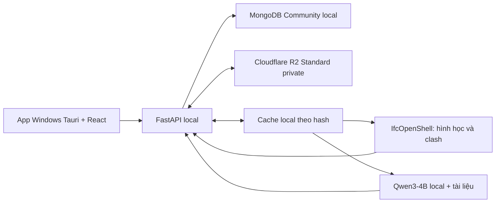

# BIM Insight — Kế hoạch triển khai và deploy app Windows trong 12 tuần

## Lớp thực hành và sinh viên · triển khai 10/11/2026

**Mục tiêu đã được yêu cầu:** lấy lớp thực hành theo học kỳ làm trung tâm. Một giảng viên sở hữu nhiều lớp, sinh viên tham gia nhiều lớp; lớp hành chính là thông tin bổ sung của thành viên. Dùng React/FastAPI/MongoDB, parser Excel/viewer/chấm điểm hiện có, không thêm dependency. Thực hiện trực tiếp trong checkout đang phát triển và giữ các thay đổi đã làm; không commit/push/deploy hoặc sửa cấu hình/dữ liệu làm việc.

**Dữ liệu và quyền:** `practice_classes` lưu mã/tên/học kỳ/mô tả/trạng thái lưu trữ/revision; `practice_class_members` lưu sinh viên và tình trạng tham gia; `practice_notifications` lưu thông báo riêng từng tài khoản. Giảng viên quản lý lớp của mình; Admin vẫn chỉ cấp danh tính/phân quyền, không tự đọc bài riêng. Sinh viên chỉ mở lớp đang tham gia, bài được giao và kết quả riêng; sau khi rời lớp vẫn giữ quyền đọc bài nộp/điểm lịch sử của mình. Lưu trữ lớp ngăn thao tác ghi mới nhưng không xóa hồ sơ.

**Giao bài và dữ liệu cũ:** thêm `class_id` tùy chọn vào bài thực hành. Giao cả lớp chốt danh sách sinh viên tại lúc giao, hoặc chọn tối đa 200 người theo giới hạn bài hiện có; thêm thành viên sau không tự sửa người nhận bài cũ. Bài cũ ở Chưa gán lớp, giảng viên gán rõ vào lớp có đủ thành viên; không tự suy từ tên nhóm, không sửa snapshot/rubric/điểm đã nộp. Trạng thái lớp và revision được kiểm tra khi thay thành viên/giao bài/nộp/chấm để tránh ghi đè hoặc thao tác khi đã lưu trữ.

- [x] **1 — Lớp và thành viên:** `backend/app/classes.py`, `class_roster.py`, các route `/api/practice/classes` trong `class_routes.py`, gắn từ `practice_routes.py`. Tạo/sửa/lưu trữ lớp; phân trang/tìm thành viên; thêm bằng tài khoản có sẵn hoặc Excel đối chiếu MSSV, không cấp password. Test `backend/tests/test_classes.py`: người ngoài/Admin/Sinh viên không quản lý lớp; mã trùng, revision cũ, Excel công thức/trùng/thiếu mã, thành viên rời lớp, lớp lưu trữ và nhiều lớp cùng sinh viên.
- [x] **2 — Bài, điểm và thông báo:** nối `practice.py` và bộ lọc route với lớp; `class_id`, gán bài cũ, danh sách nhận bài bất biến, điểm riêng và bảo toàn lịch sử. Bảng điểm một bài cho toàn bộ người được giao gồm cả chưa nộp, bài mới chờ chấm vẫn giữ kết quả đã công bố của lần trước; xuất Excel đúng lớp, mọi ô nhập là text khi xuất. Thông báo thêm lớp/giao bài/nộp bài/công bố điểm có đánh dấu đã đọc và danh sách hạn sắp tới, chỉ trong app.
- [x] **3 — Giao diện:** `ClassWorkspace.tsx`, `ClassMembers.tsx`, `ClassGradebook.tsx`, `PracticeNotifications.tsx`; tái sử dụng `PracticeWorkspace` khi giao/nộp/chấm trong lớp. Menu giảng viên có Lớp giảng dạy, sinh viên có Lớp của tôi; chi tiết lớp luôn có mã/tên/học kỳ và tab Tổng quan/Thành viên/Bài thực hành/Bảng điểm phù hợp vai trò. Giữ các công cụ và bài chưa gán lớp ở mục phụ, giao diện User/Admin hiện có.
- [x] **4 — Kiểm chứng và bàn giao:** API đỏ→xanh, Playwright lớp→thành viên→giao→nộp→chấm→điểm/Excel/thông báo, thêm/gỡ/lưu trữ, desktop/mobile và User baseline. Test dùng database localhost/thư mục riêng và tự dọn; build, kiểm tra hồi quy phần practice/access và review độc lập cuối. Ghi bằng chứng `.local/classes-20261110/`, cập nhật cuối README; không coi fixture là nghiệm thu chuyên ngành hoặc triển khai nhiều máy.

**Đã kiểm chứng:** 384 backend tests đạt/3 ca tùy chọn skip dưới tài khoản Windows thực, gồm 7 ca lớp/thành viên/điểm/Excel/nhắc hạn/ghi đồng thời/lưu trữ trong lúc Qwen chạy. Build và hai parser stream đạt. Playwright bốn vai trò desktop/390 px hoàn tất tạo lớp → thêm sinh viên/Excel → giao cả lớp → nộp IFC → cô lập cặp/tải nguồn → chấm nháp/công bố → bảng điểm/Excel/thông báo. Kiểm tra chuyển bài khi request chậm, chuyển lớp A sang lớp B rỗng, Student không thấy lớp khác/danh sách lớp/điểm nháp và lớp lưu trữ chặn nộp. So sánh menu/ảnh User baseline khớp, che canvas đang quay; không có lỗi JavaScript.

Review độc lập đã tìm và sửa giữ lựa chọn bài từ lớp trước, hàng bảng điểm cũ khi chuyển bài và liên kết thông báo của bài được gán lớp sau. Các ca đỏ→xanh bổ sung bảo vệ alias MSSV/tên đăng nhập trùng tài khoản, nhắc hạn lớp lưu trữ và cạnh tranh chấm/lưu trữ. Thao tác cạnh tranh trả `project_busy` để thử lại, giữ chính sách khóa hiện có. Điểm và snapshot trước khi gán lớp/rời lớp giữ nguyên.

Minh chứng `.local/classes-20261110/verification.json`, JUnit, ảnh và Excel. Dữ liệu thử chỉ ở localhost và thư mục riêng, đã dọn; không sửa tài khoản/cấu hình/hồ sơ làm việc hoặc ghi Atlas/R2. UI Qwen dùng phản hồi kiểm soát, API chặn lưu khi lớp vừa lưu trữ; không chạy lại model thật hoặc fine-tune ở mốc lớp. Chưa build bộ cài, triển khai API trung tâm hoặc nghiệm thu nhiều máy. Cách chạy và thao tác tại mục14 cuối README.

## Ba không gian theo vai trò · triển khai 10/11/2026

**Thiết kế đã được yêu cầu:** Admin quản trị hệ thống, giảng viên giao/chấm bài thực hành, sinh viên tự kiểm tra/nộp/xem phản hồi. Giữ nguyên màn hình và chức năng Người dùng. Tiếp tục React/FastAPI/MongoDB, viewer và Qwen hiện có; không thêm dependency hoặc khóa học/video. Dự án cá nhân cũ vẫn mở được qua mục phụ. Nhà 3D và màu retro giữ lại nhưng gọn hơn trên ba không gian mới.

**Luồng tối thiểu dùng thật:** giảng viên tạo bài với bảng tiêu chí và sinh viên được giao; sinh viên chọn dự án/lượt kiểm tra đã lưu để nộp một snapshot; giảng viên xem đúng minh chứng, lưu nháp hoặc công bố điểm/nhận xét theo tiêu chí. Điểm tính từ rubric do giảng viên xác nhận, không quy đổi số va chạm thành điểm. Qwen chỉ phân tích bằng chứng hình học, không tự công bố điểm. Các tiêu chí ngoài dữ liệu IFC/PDF hiện có cần người chấm xác minh.

**Ràng buộc:** bản nộp giữ ID/hash nguồn và rubric; đổi hồ sơ tạo lần nộp mới. Đánh giá chính thức tách khỏi nhãn tự rà soát và chỉ giảng viên phụ trách được sửa. Admin không mặc nhiên đọc bài riêng. Chặn xóa dự án đang được dùng làm minh chứng bài đã nộp. Hạn nộp tùy chọn; bài muộn được ghi nhận rõ, không tự trừ điểm. API dùng phân trang, kiểm tra vai trò/quyền và phiên bản khi ghi. Không thay tài khoản/cấu hình/hồ sơ làm việc hoặc tự train/publish.

- [x] **A — Dữ liệu thực hành:** tạo `backend/app/practice.py`, `practice_routes.py`, test `backend/tests/test_practice.py`; tích hợp vào `main.py`, quyền đọc đúng artifact trong `access.py` và giữ minh chứng trong `project_cleanup.py`. Test người ngoài/sinh viên sửa điểm, snapshot sau cập nhật nguồn, nháp chưa công bố, điểm vượt rubric, nộp lại và xóa dự án.
- [x] **B — Quản trị:** thêm thống kê và nhật ký admin trong `access.py`/`access_routes.py`; tái sử dụng cấp Excel/Gmail và trạng thái dịch vụ. Số liệu thật, không tạo dashboard mẫu.
- [x] **C — Giao diện:** `RoleWorkspace.tsx`, `PracticeWorkspace.tsx`, `PracticeEvidence.tsx` và CSS chỉ áp dụng ba role; nối menu tại `Workbench.tsx`, giữ nhánh User hiện tại. Tạo/giao/nộp/chấm/công bố/xuất kết quả hoạt động với API; viewer/Qwen có hủy và giới hạn hiện có.
- [x] **D — Kiểm chứng:** baseline User trước sửa; kiểm thử API và Playwright bốn vai trò desktop/mobile, luồng hoàn chỉnh và quyền dữ liệu; build, review độc lập, chạy hồi quy liên quan; ghi kết quả và giới hạn tại mục này/README. Không coi UI hoặc kiểm thử kỹ thuật là nghiệm thu điểm chuyên ngành.

**Kết quả kiểm chứng 10/11:** build frontend đạt; bộ backend đầy đủ đạt 373 ca/3 skip tùy chọn. Sau khi chỉnh prompt chung để Qwen không lặp ưu tiên cùng nhóm, 29 ca hồi quy phần tổng hợp/bài thực hành đều đạt. Playwright bốn vai trò đi hết giao bài → chọn sinh viên → nộp IFC/lượt kiểm tra → mở cặp cấu kiện trong 3D/tải nguồn → lưu nháp → công bố → sinh viên tải kết quả. Đã kiểm tra lọc tài khoản, mục cấp tài khoản/dịch vụ/nhật ký, menu cửa sổ thấp và màn hình 390 px; không có lỗi JavaScript. Nhánh Người dùng khớp menu và ảnh baseline trước sửa, che riêng canvas đang quay.

Qwen3-4B NF4 thật qua API bài nộp trả HTTP 200 sau khoảng 43 giây cho ba IFC tổng hợp/hai cặp; đã xác minh trọng số, lưu và mở lại phân tích, không tự tạo điểm và không lộ phân tích riêng cho sinh viên. Trường hợp model lặp nhóm bị từ chối trước khi lưu; prompt đã giới hạn số ưu tiên theo nhóm và vẫn giữ bộ kiểm tra đầu ra. UI tạo/hủy/khóa ô điểm/giải phóng viewer dùng phản hồi kiểm soát; phép thử model thật thực hiện riêng ở API. Không dùng số đo này để suy ra tốc độ trên công trình lớn hoặc độ đúng chuyên ngành.

Minh chứng tại `.local/role-workspaces-20261110/` (JUnit, ảnh, `ui-result.json`, `native-ai.json`). Database/thư mục xử lý thử riêng đã dọn, không ghi Atlas/R2 làm việc hoặc thay tài khoản/cấu hình/hồ sơ gốc. Đã review mã độc lập và sửa các lỗi tìm thấy. Chưa build lại bộ cài, chưa nghiệm thu nhiều máy qua Atlas/R2 hoặc chất lượng chấm điểm chuyên ngành; Qwen chưa fine-tune. Hướng dẫn chạy và thao tác theo vai trò ở cuối README, mục 13.

## Kết luận tổng thể bằng Qwen · triển khai 09/11/2026

Bổ sung bản tổng hợp theo từng lượt kiểm tra, dùng runtime Qwen3-4B/NF4 local đã có. Backend thống kê toàn bộ bằng chứng đã lưu và trạng thái rà soát, chọn tối đa 6 nhóm tiêu biểu để giữ prompt gọn; Qwen viết nhận định ngắn, chọn nhóm ưu tiên và bước tiếp theo. Số liệu, giới hạn độ phủ và trạng thái kết luận do backend giữ chính xác; không dùng AI để sửa kết quả hình học hoặc tự coi là nghiệm thu thiết kế.

Triển khai theo thứ tự: (1) thống kê/kiểm tra đầu ra có kiểm thử; (2) tái sử dụng worker Qwen, khóa xử lý/hủy, xác minh trọng số; (3) API/lưu lịch sử riêng trong MongoDB và xóa cùng dự án; (4) panel trên bảng kết quả, nút tạo/hủy/tải JSON và mở cặp minh chứng; (5) kiểm thử phân quyền, dữ liệu vượt 100 cặp, đầu ra sai, UI desktop/mobile và chạy Qwen thật. Bản lưu giữ snapshot cùng nguồn/hash/model; cảnh báo khi nhãn đã thay đổi. Không chạy lại toàn bộ IFC hoặc yêu cầu DXF để tạo kết luận.

**Đã triển khai và kiểm tra:** GET/POST `/api/projects/{project_id}/runs/{run_id}/conclusions`, collection `project_conclusions`, lịch sử bất biến, JSON và chọn 3D. Thống kê đọc toàn bộ báo cáo, không phụ thuộc trang/bộ lọc; chỉ đưa mức tổng hợp cùng nhóm tiêu biểu vào prompt để tránh biến số lượng nhãn thành số đo. Trạng thái `incomplete` và nhóm bề mặt được giữ bảo thủ. Output sai cấu trúc/nhóm/nguồn/số đo không được lưu. Phiên đăng nhập, vai trò, quyền dự án và tình trạng đang xóa được kiểm tra lại trước khi lưu; đã thử thu hồi quyền/vô hiệu hóa/đăng xuất khi model đang chạy.

Qwen3-4B NF4 thật đã trả kết luận qua API trên bản sao báo cáo 9.014 cặp (6.583 giao hình học, 2.431 bề mặt), thống kê 1.258 nhóm/chọn 6 nhóm, khoảng 44–46 giây gồm hash/nạp/sinh, GPU reserved peak khoảng 2,86 GiB. Giữ nguyên nguồn/checksum, nhãn và đề xuất theo từng cặp; database thử chỉ ở localhost và được dọn. Playwright desktop/375 px qua tạo/hủy/đầu ra lỗi/thử lại/lịch sử/stale/JSON/focus 3D/khóa tác vụ/giải phóng viewer; phản hồi AI ở UI là fixture, kiểm chứng Qwen thật nằm ở phép thử API riêng. Review mã độc lập đã thực hiện, không gọi cloud hoặc đọc key. Minh chứng `.local/run-conclusions-20261109/` và `%TEMP%/bim-insight-run-conclusions-20261109/`. Chưa fine-tune/đánh giá độ đúng chuyên ngành hoặc build bộ cài mới.

**Kiểm tra cuối:** 351 backend tests đạt/3 skip dưới tài khoản Windows thực (bao gồm DPAPI), build frontend và hai parser stream đạt, UI không lỗi JavaScript. Ca phân quyền bao gồm thành viên chỉ xem, người ngoài, giáo viên rà soát, thu hồi vai trò/thành viên, vô hiệu hóa và đăng xuất giữa lúc suy luận; dự án đang xóa không sinh kết luận mồ côi. Chạy lại Qwen thật sau sửa quyền trước khi lưu đạt API 200 trong 45,94 giây. Biên bản tổng hợp `.local/run-conclusions-20261109/verification.json`; XML kết quả `backend-final.xml`. Giữ nguyên dữ liệu làm việc Atlas/R2 và chưa nghiệm thu AI chuyên ngành.

## Sửa quyền cache trên tài khoản Windows chạy app · 09/11/2026

Hai lượt thực tế sau bàn giao bị `clash_geometry_failed` sau khi dựng đủ Plumbing. Đã xác minh cache chuyển từ môi trường kiểm thử giữ quyền riêng của `CodexSandboxOffline`; tài khoản app bị từ chối đọc cả manifest/IFC định danh/HDF. Cùng IFC/mapping dựng tốt với 1 và 2 luồng. Đã bỏ script chuyển cache, chỉ dọn 5 cache dẫn xuất do sandbox tạo rồi để luồng cache của app tạo lại bằng đúng tài khoản Windows thực; giữ nguyên nguồn, mapping, các báo cáo/lượt cũ, tài khoản/cấu hình và MongoDB/R2.

Bộ xử lý báo riêng `clash_cache_permission_denied` và không dựng lại hoặc xóa cache khi chưa có quyền. UI làm rõ DXF tùy chọn; đã thử chạy 3 IFC không tải DXF, không có liên kết mặt bằng, vẫn trả kết quả đúng. Kiểm thử UI lỗi quyền dùng fixture; kiểm tra ACL và chạy lại 5 nguồn thật dùng tài khoản Windows thực.

Lượt sửa chạy đúng nguồn/ID/thứ tự/tham số người dùng: đủ 18.783 cấu kiện, không thiếu hình học, đủ 557/557 lô; 6.583 giao khối và 2.431 giao bề mặt cần rà soát. `partial` do 251 mesh chưa kín; không phải lỗi cache. Bằng chứng mới `.local/clash-cache-fix-20261109/`. Việc đưa 5 cache vào app ở biên bản trước chỉ được xác minh trong sandbox và đã được thay thế; không suy ra quyền của tài khoản app từ kết quả kiểm thử đó.

Khởi động lại bằng `npm.cmd start` và chạy lượt mới trong dự án đang có; không cần nhập lại IFC, bổ sung DXF hay xóa lịch sử. Chưa build lại bộ cài Windows hoặc benchmark IFC 1–2 GiB.

**Kiểm tra cuối bản sửa quyền:** hai lượt dùng đúng dữ liệu người dùng khớp toàn bộ 9.014 cặp và độ phủ; 304,7/153,1 giây, RSS cây worker tối đa khoảng 1,58 GiB. Đã xác minh đọc được cả 5 cache dưới tài khoản Windows chạy app. 335 backend tests đạt/3 skip; build, parser stream và UI desktop/mobile đạt, không lỗi JavaScript. Minh chứng `.local/clash-cache-fix-20261109/verification.json`. Các báo cáo lỗi cũ không bị ghi đè; cache được tạo lại theo đúng quyền thay cho cache sandbox.

## Phân loại hình học IFC và phạm vi va chạm · 09/11/2026

Bộ đọc mới phân loại theo biểu diễn thực tế: cấu kiện vật lý, đối tượng cha, lỗ mở, đường/điểm tham chiếu và phần chưa đánh giá. Kiểm tra va chạm kiểm kê lại IFC gốc, xác minh checksum và đơn vị; không dùng danh sách cấu kiện dựng thành công ở GLB để giới hạn phạm vi. Lỗ mở phải dựng thành thể tích kín hợp lệ; lỗ lỗi và cấu kiện chủ bị ảnh hưởng không được nhận là hình học đúng. Lô dựng hình lỗi được thử lại từng cấu kiện; phần còn thiếu vẫn ngăn kết luận đầy đủ. JSON đầy đủ lưu kiểm kê và nguyên nhân từng trường hợp.

64 cảnh báo Architecture Snowdon ngày 08/11 đã được xác minh là các proxy Annotation/GeometricSet chỉ có đường, không phải 64 cấu kiện vật lý bị mất. Bộ đọc policy 4 tách riêng nhóm này; không bỏ hàng loạt theo tên hoặc loại Proxy. Cả 5 IFC đã nhập lại thành công, giữ 18.783 cấu kiện vật lý và không thiếu hình học ở bước nhập. Đã thử giao diện mở đủ 5 mô hình, xem số tham chiếu, xuất đầy đủ kiểm kê và kiểm tra/xem 3D cặp Electrical–HVAC gồm 4.734 cấu kiện. Đây là kiểm chứng kỹ thuật, chưa phải nhãn chuẩn hoặc phê duyệt thiết kế.

Để tránh RAM tăng tích lũy qua các cặp, app chuẩn bị cache từng nguồn rồi tách mỗi cặp IFC sang tiến trình riêng khi phối hợp nhiều hơn hai IFC. Giới hạn RAM vẫn áp dụng cho cả cây tiến trình. Cặp không có hình học không chạy kernel; phần thiếu của nguồn vẫn nằm trong độ phủ. Lưới cho ngưỡng giao nhỏ hơn 1 mm được làm mịn tương ứng. Cache cũ được phân biệt theo policy; nhập lại cùng IFC sẽ tạo báo cáo mới khi bộ đọc thay đổi, giữ lịch sử cũ.

Áp dụng: khởi động lại `npm.cmd start`, chọn đúng dự án và nhập lại IFC cùng nguồn; không cần tạo Revision hoặc xóa dự án. Các mốc kỹ thuật cũ bên dưới được giữ làm lịch sử. Chưa đóng gói lại bộ cài Windows hoặc bảo đảm đọc được mọi IFC 1–2 GiB trên mọi cấu hình RAM.

**Kiểm chứng cuối:** Snowdon đủ 19.802 đối tượng `IfcElement`, 18.783 cấu kiện vật lý, 64 tham chiếu, 798 phần khoét và 157 đối tượng cha. Hard từ cache trống/dùng lại lần lượt 371,7/151,3 giây, khớp 9.022 bằng chứng và độ phủ; clearance 163,5 giây với 22.559 cặp cần xem xét. Cả ba lượt đủ 684/684 lô, không thiếu hình học, RSS cây worker tối đa 1,59 GiB dưới ngân sách thử 1,75 GiB. Giữ trạng thái `partial` do 251 mesh chưa kín và giao bề mặt cần rà soát; không phải nghiệm thu lỗi thiết kế. 333 backend tests đạt/3 skip; build, stream và giao diện desktop/mobile đạt. Đã chuẩn bị 5 cache đã xác minh cho app, giữ nguyên nguồn/tài khoản/cấu hình/trọng số và không ghi dữ liệu thử vào Atlas/R2. Minh chứng `.local/ifc-coverage-20261109/verification.json`.

## Quản lý dự án và xóa dữ liệu liên quan · 09/11/2026

Đã bỏ thao tác Revision thủ công khỏi luồng sử dụng: chọn dự án → nhập hồ sơ → phối hợp/kiểm tra. Tệp cùng nguồn được cập nhật tự động; hồ sơ hiện tại chọn bản mới nhất, lịch sử dùng nguyên mã nguồn/hash của lượt cũ. Giữ khả năng đọc metadata/API cũ để không mất dữ liệu. Các mô tả Revision thủ công trong biên bản trước đây là lịch sử.

Chủ dự án có nút **Xóa dự án**, xác nhận trước khi xóa vĩnh viễn tệp/bản xem/cache riêng, kết quả, liên kết, nhãn, đề xuất AI và metadata dự án trong MongoDB/R2. Tệp dùng chung chỉ được dọn khi dự án cuối cùng được xóa. Giữ tài khoản, cấu hình, hồ sơ nguồn, trọng số/adapter và bản xuất ngoài app. Xóa lỗi giữ trạng thái để thử lại; có khóa MongoDB giữa các thiết bị, giữ tiến trình hoàn tất khi mất kết nối và ghi nhận giải phóng quota theo token để tránh tính hai lần.

Đã thử luồng trên Chromium desktop/mobile, nhập bản sửa không Revision, căn khớp/va chạm, khôi phục lượt cũ, Escape/hủy và xóa có dữ liệu dùng chung. Test lỗi R2, lỗi metadata/quota, hai app cùng xóa, phân quyền và đường dẫn dùng MongoDB localhost riêng. R2 thật đã thử 1 IFC mẫu mới 3.385 byte qua 2 dự án tạm và dọn hết dữ liệu thử; không xóa dự án làm việc. Minh chứng `.local/project-lifecycle-20261109/`. Cần khởi động lại source bằng `npm.cmd start`; chưa đóng gói lại bộ cài Windows.

## Sửa nhập IFC Snowdon và tiến độ RAM · 08/11/2026

**Đã triển khai:** worker tránh nạp HTTP/AI khi chỉ đọc IFC; chọn lô 64/128/512 theo ngân sách RAM được giao và giải phóng mô hình native trước khi tối ưu GLB. Không tăng giới hạn RAM hoặc đổi tham số hình học. App tạm đóng trình xem IFC khi nhập/kiểm tra, hiển thị bước xử lý, số đối tượng, RSS hiện tại/đỉnh/ngân sách và RAM hệ thống trống. Số đo được lưu cả khi thất bại và trong JSON tải xuống. Luồng nhập gửi tiến độ/nhịp phản hồi; báo mất kết nối khi luồng đã mở im lặng quá 30 giây. Sửa lựa chọn dự án đã bị xóa gây 404 và việc tải lại danh sách ghi đè tệp đang xem.

**Kiểm chứng thực tế:** nhập 5 IFC Snowdon từ `data/inputs/37/MODEL` trên giao diện với ngân sách worker 0,85 GiB; mở đủ 5/5 mô hình, JSON Architecture đủ 6.393 cấu kiện. Architecture 92,5 MiB chạy 116,7 giây, RSS đỉnh đo được 773,1 MiB; còn 64 cấu kiện `geometry_failed`, giữ báo cáo `partial`. Electrical/HVAC/Plumbing/Structural đọc hoàn tất lần lượt 2.107/2.627/6.404/1.252 cấu kiện. Đây là bằng chứng nhập/xem, chưa phải đánh giá va chạm toàn bộ công trình hoặc phê duyệt chuyên gia.

194 kiểm thử backend liên quan đạt, 3 skip; parser luồng nhập/va chạm, giao diện RAM desktop/mobile và build frontend đạt. File `200.js` có `M_ID` tại vị trí tương ứng thuộc Urban VPN Proxy 5.14.4; trình duyệt thử sạch không tái hiện lỗi. Giữ nguyên tiện ích và cấu hình trình duyệt. Kiểm thử dùng database localhost/thư mục riêng đã dọn; không ghi Atlas/R2 làm việc, checksum 5 IFC gốc giữ nguyên. Minh chứng `.local/snowdon-20261108/verification.json`. Khởi động lại source bằng `npm.cmd start` để áp dụng; có thể nhập lại tệp thất bại trong dự án/revision hiện có. Chưa benchmark IFC 1–2 GiB, chưa chạy lại toàn bộ test repository hoặc build lại bộ cài Windows.

**Lịch sử dọn dữ liệu · 08/11/2026:** tại thời điểm dọn đã xóa dữ liệu dự án/test trong MongoDB, 4 lượt kiểm tra/20.956 kết quả và khoảng 2,55 GiB tệp/cache sinh ra; R2 được xác minh rỗng lúc đó. Giữ 2 tài khoản, cấu hình mã hóa, hồ sơ nguồn, trọng số Qwen và adapter; checksum 438 tệp trước/sau khớp. Biên bản `.local/cleanup-20261108-result.json`; các mục kiểm chứng Office/Timber dưới đây là lịch sử, cache/GLB test cũ đã dọn. Sau đó người dùng đã nhập bộ Snowdon mới; bản sửa này không dọn dữ liệu làm việc đó.

## Khắc phục giới hạn bản xem Office · 08/11/2026

**Đã triển khai:** tối ưu GLB bằng cách chia sẻ buffer/accessor giống hệt, giữ toàn bộ cấu kiện, GUID, phép biến đổi, tam giác, pháp tuyến và vật liệu. HVAC Office nguồn 344.545.776 byte có 47.525 cấu kiện và 10.910.233 tam giác; GLB giảm từ 319.263.676 xuống 43.451.580 byte, đủ điều kiện mở 3D trong giới hạn cũ. Đã đối chiếu từng cấu kiện và metadata với lượt tham chiếu. Kiểm tra va chạm vẫn dựng từ IFC gốc; đây là bản sửa bước nhập/xem, chưa phải kiểm chứng va chạm toàn bộ Office.

**Tài nguyên và lỗi:** dựng theo lô tối đa 512 cấu kiện, giải phóng iterator giữa các lô, tiếp tục các lô khỏe khi một lô lỗi và ghi rõ phần chưa dựng được. Lỗi tối ưu không làm mất mapping hoặc bản xem gốc còn hợp lệ. Worker HVAC Office hoàn tất 216,36 giây, đỉnh RSS 3.800 MiB dưới ngân sách 3,95 GiB. Bản xem còn nhiều hình học riêng biệt vẫn có thể vượt giới hạn; chưa benchmark IFC 1–2 GiB. Không đổi giới hạn tài nguyên hoặc giảm độ chi tiết để bỏ qua cảnh báo.

**Kiểm chứng:** 278 kiểm thử backend đạt trong sandbox; 15 ca dùng DPAPI không chạy được với profile sandbox đã chạy lại dưới tài khoản Windows và đều đạt, 2 ca tùy chọn skip. Build frontend đạt. Chromium mở 5/5 GLB Office thật, tổng 76.491 cấu kiện, chọn theo GUID từng nguồn, xoay/zoom, desktop/mobile và tải JSON đầy đủ 47.525 cấu kiện HVAC; không có lỗi JavaScript. Database test chỉ ở localhost và được dọn. Minh chứng `.local/office-viewer-20261108/verification.json`; giữ nguyên nguồn, Atlas/R2 và tài khoản/cấu hình làm việc. Chưa build lại bộ cài Windows hoặc chạy toàn bộ va chạm Office.

**Sử dụng:** khởi động lại bằng `npm.cmd start`, mở revision mới như `R02` và nhập lại bộ IFC Office để tạo bản xem đã tối ưu. Cùng nguồn/cùng revision giữ báo cáo bất biến đã lưu; không ghi đè báo cáo/R2 cũ khi nâng bộ xử lý. Hướng dẫn chạy chi tiết ở cuối README.

## Khắc phục bộ nhớ và kiểm chứng va chạm Timber · 08/11/2026

**Kết quả kỹ thuật đã đạt:** bộ kiểm tra local chạy 4 IFC Timber, 12.625 cấu kiện ở chế độ clearance với ngưỡng giao 0,1 mm/khoảng hở 10 mm. Từ cache trống: 211,45 giây, đỉnh RSS 2.757 MiB; dùng lại cache: 47,99 giây, đỉnh RSS 2.755 MiB. Cả hai nằm trong ngân sách thử 2,95 GiB, khớp toàn bộ 14.100 bằng chứng và coverage. JSON đầy đủ khoảng 16,69 MiB; có 7.666 giao hình học, 5.174 khoảng hở và 1.260 giao bề mặt cần rà soát. Báo cáo là `partial` do 2 cấu kiện nguồn thiếu hình học và 3.250 lưới chưa kín; chưa có nghiệm thu thiết kế hoặc ground truth công trình cho ngưỡng 0,1 mm.

**Triển khai:** body chỉ gồm các `IfcTriangulatedFaceSet`/`IfcPolygonalFaceSet` qua mapped item được đọc bằng kernel mesh hiện có khi không có feature cắt/bổ sung trực tiếp hay kế thừa. Không đưa khối tham số, đường cong hoặc Boolean vào nhánh này; chúng tiếp tục dùng OpenCascade với tham số chia lưới 0,5 mm. Giới hạn mỗi iterator 128 cấu kiện, tách worker theo nguồn và hoàn tất tạo cache mọi IFC trước khi nạp BVH. Lưới chính xác lưu HDF cùng IFC định danh gọn và manifest, khóa theo cache giữa các tiến trình; kiểm tra nguồn/mapping/phiên bản/cấu hình và checksum, tự dựng lại khi cache hỏng. Cache phiên bản 2 phân biệt chiến lược đọc mesh với phiên bản trước.

**Dùng trên máy hiện tại:** đã xác minh IFC/mapping gốc không đổi và chép đúng 4 cache đã kiểm chứng vào `data/inspections/cache/clash-geometry`, khoảng 1,32 GiB local. Không ghi dữ liệu thử vào Atlas/R2 hoặc đổi tài khoản/cấu hình; cache dẫn xuất không backup lên R2. Dừng terminal chạy app, chạy `npm.cmd start` để nạp backend mới rồi chọn hồ sơ cũ và kiểm tra. Bộ cài Windows chưa build lại; chưa benchmark IFC 1–2 GiB.

**Xác minh cache trong app:** chạy dưới tài khoản Windows thực tế, dùng nguyên IFC/mapping gốc và cache đã chép, chặn dựng lại để kiểm tra khả năng tái sử dụng. Đạt 46,12 giây, đỉnh RSS 2.753 MiB trong ngân sách 2,95 GiB; các bằng chứng và coverage khớp toàn bộ lượt tham chiếu. Tệp gốc và quyền truy cập gốc giữ nguyên.

**Kiểm chứng:** 115 backend tests đạt/2 skip; kiểm thử bổ sung mặt đa giác có lỗ đạt ở cả hai kernel. Giữ cả lỗ đã bake vào mesh và lỗ Boolean; loại khỏi nhánh mesh khi có feature trên cha hoặc có đường cong/khối tham số. Kiểm thử hai tiến trình xác nhận khóa cache, lỗi cache/hash, nguồn có phần thiếu, phần tử qua nhiều lô, chuẩn bị toàn bộ nguồn trước nạp BVH, hủy dừng cả worker con và lưu số liệu khi chạm RAM. 16 mẫu HVAC thật khớp giữa các cỡ lô và qua HDF. Build frontend đạt; Playwright đạt tiến độ/hủy/reset kết nối/giới hạn chờ/số liệu RAM/mobile, 13 tệp/6 IFC/2.204 cấu kiện/1.100 giao hình học tổng hợp, xuất đủ và mở lại dự án. Minh chứng `.local/clash-memory-20261108/verification.json`; các mục ngày 07/11 dưới đây là mốc lịch sử trước bản sửa này.

## Phản hồi tiến độ và hủy kiểm tra va chạm · 07/11/2026

**Vấn đề thực tế:** người dùng nhập bộ Timber và chờ lâu ở bước va chạm, sau đó proxy báo `ECONNRESET`. Kiểm tra cho thấy bước va chạm vẫn dựng lại hình học OpenCascade chính xác 0,5 mm; thời gian đọc/GLB 20–50 giây không phải thời gian va chạm. Chẩn đoán một luồng sau 180 giây mới khoảng 1.500 cấu kiện; hai luồng vẫn đang dựng HVAC khi dừng phép thử tại 900 giây, đỉnh RSS khoảng 2.719 MiB. Không coi lượt chẩn đoán này là kiểm tra toàn bộ hoàn tất. Bộ Timber có 4 IFC/12.625 cấu kiện vật lý, 2 đối tượng thiếu hình học trong nguồn Kết cấu.

**Triển khai:** dùng lại lựa chọn 1–2 luồng theo ngân sách RAM cho phần dựng hình chính xác, không đổi bộ máy hoặc sai số; giải phóng iterator khi xong nguồn. Worker cập nhật tệp tiến độ trong thư mục tác vụ. Client chọn NDJSON trên cùng endpoint POST, nhận mô hình/cấu kiện/lô/thời gian và nhịp phản hồi 2 giây. Client JSON cũ và JSON lưu/xuất giữ nguyên. Giao diện phát hiện luồng kết thúc thiếu kết quả, ngắt giữa luồng và 30 giây không còn nhịp; chặn chờ vô hạn trước header/tổng lượt. Kết quả đầy đủ không tự hủy kết nối HTTP sau frame cuối. Hủy/đứt kết nối dùng AnyIO shield chờ worker dừng và dọn tác vụ, giữ quyền kiểm tra artifact trước khi mở stream.

**Kiểm chứng:** 78 backend tests đạt, 2 skip trong nhóm clash/progress/inspection/capacity/projects/pilot. Có RED→GREEN cho tiến độ, AnyIO cancellation và bảo toàn kết thúc HTTP; test worker thật xác nhận PID đã dừng trước khi đóng stream. Parser giữ UTF-8 khi chia nhỏ chunk, kết quả lớn, lỗi có cấu trúc, ngắt thiếu kết quả và tương thích JSON. Build frontend đạt; Playwright đã chạy clash nhỏ bằng kernel thật, tiến độ trước khi có kết quả, hủy, mô phỏng `ECONNRESET` qua proxy, watchdog mở lại giao diện, kết quả `partial` và desktop/mobile. Ảnh tiến độ là fixture truyền dẫn có nhãn, không phải ảnh nghiệm thu Timber.

**Dữ liệu và giới hạn:** đọc đúng 4 IFC Timber cùng mapping do app đã nhập, sao chép riêng để thử và đối chiếu hash; giữ tệp/ACL, tài khoản, cấu hình và dự án gốc. Các thử nghiệm reuse/cache chưa chứng minh phù hợp được loại bỏ, không đưa vào source sử dụng. Không có lượt va chạm toàn bộ Timber hoàn tất trong đợt chẩn đoán; không đưa ra kết luận kỹ thuật cho công trình này. Bộ cài Windows chưa build lại. Dùng `npm start`, giữ terminal mở và dùng nút Hủy trong app; dữ liệu thử không ghi Atlas/R2 làm việc. Minh chứng lưu tại `.local/clash-fix-20261107/`.

## Khắc phục đọc IFC thật và đơn giản hàng đợi · 07/11/2026

**Phạm vi:** bỏ ô chọn bộ môn trên từng tệp, kiểm tra bằng bộ đầu vào mới `data/inputs/35`; giữ toàn bộ 403 tệp nguồn, tài khoản, cấu hình và dữ liệu làm việc. Kiểm thử ở database localhost/thư mục riêng, không ghi Atlas hoặc R2 làm việc.

**Cập nhật tăng tốc sau yêu cầu tiếp theo:** tự dùng 2 luồng dựng hình khi có ít nhất 2 lõi CPU vật lý và ngân sách RAM worker đạt 2,5 GiB, chọn trước khi parse IFC; trường hợp khác giữ 1 luồng. Không đổi sai số lưới, kiểm tra lỗ mở hoặc cấu hình va chạm. Benchmark trực tiếp cùng HVAC: 1 luồng 77,6 giây/đỉnh RSS 1.655 MiB; 2 luồng 42,2 giây/2.066 MiB. Đối chiếu 7.211 GUID, số tam giác, bounds và từng buffer mesh/transform GLB đều khớp. Hai luồng cũng đọc ARK trong 21,6 giây và STRUC 39,0 giây; STRUC giữ 8 cảnh báo thiếu hình học của nguồn. Các thời gian là bước nhập/GLB ở bộ xử lý; chưa phải benchmark toàn giao diện với lựa chọn luồng tự động. 101 kiểm thử liên quan đạt, 2 skip, gồm ngưỡng RAM/CPU, chọn luồng trước parse và kiểm tra khoét lỗ ở cả hai chế độ. Minh chứng: `.local/ifc-fix-20261107/speed-verification.json` và `speed-geometry-comparison.json`. Khởi động lại backend bằng `npm start` để áp dụng; không bảo đảm tăng tốc khi máy thiếu RAM.

**Đã triển khai:** nhận diện nhãn bộ môn từ tên gốc ARK/ARCH, STRUC/STR, MEP/HVAC/ELE; tên không chắc chắn giữ OTHER. IFC dùng geometry iterator hybrid để tái sử dụng biểu diễn lặp; fallback OpenCascade riêng cho đối tượng chưa phát ra, đọc buffer và tính bounds theo lô. Preview giữ độ chia lưới mặc định 1 mm; kiểm tra va chạm dùng IFC gốc với cấu hình 0,5 mm hiện có. Chọn đúng Body, gộp nhiều Body cùng hệ tọa độ dưới một GUID; không tự ghép các Body khác hệ quy chiếu. Lỗ mở của cấu kiện và cấu kiện cha dùng cùng quy tắc ở nhập/va chạm, vẫn kiểm tra hình học để báo phần khoét rỗng/hỏng; không vẽ lỗ mở thành khối đặc. Đếm riêng cấu kiện vật lý, phần khoét và đối tượng cha.

**Bằng chứng đọc thực tế:** lượt UI cuối trên giao diện đã build mở đủ 4 IFC, một DWG và một DXF của bộ 35, không còn dropdown bộ môn; xem 4/4 mô hình, tải JSON IFC đầy đủ và kiểm tra bố cục desktop/mobile. Thời gian: ARK 76,5 MiB — 36,0 giây/1.359 cấu kiện; ELE 1,3 MiB — 3,9 giây/687 cấu kiện; HVAC 91,5 MiB — 78,5 giây/7.211 cấu kiện; STRUC 8,5 MiB — 77,2 giây/621 cấu kiện. STRUC có 16.200 phần khoét, 568 đối tượng cha và **8 đối tượng thiếu biểu diễn ngay trong IFC nguồn**, giữ kết quả `partial`. DWG/DXF thử nghiệm đọc được, không suy rộng thành đã kiểm toàn bộ 201 bản vẽ CAD. Benchmark riêng ARK: đường cũ chưa xong ở mốc dừng thử 300 giây/đỉnh RSS khoảng 3.096 MiB; iterator hybrid khoảng 38 giây/1.701 MiB, sau đó fallback bổ sung một cửa chưa được iterator phát ra.

**RAM và cách chạy:** các lượt dev dưới áp lực RAM từng bị chặn ARK/HVAC; có lúc toàn máy chỉ còn khoảng 1,15 GiB trống. Không tắt bộ bảo vệ RAM hoặc đóng ứng dụng của người dùng. Thêm `npm start`: build frontend rồi chạy giao diện đã build cùng backend local qua launcher dùng chung, giữ proxy xác thực trên 127.0.0.1:1420. Bản này đọc đủ cả 4 IFC trong lượt cuối; launcher riêng đã qua kiểm tra HTML build/proxy API và dọn sau khi dừng. `npm run dev` tiếp tục phục vụ sửa code/cập nhật trực tiếp. Nên dành khoảng 4–5 GiB RAM trống; 2 GiB/tệp là giới hạn nhận đầu vào, chưa phải cam kết xử lý mọi mô hình trên laptop.

**Hồi quy và giới hạn:** 144 backend tests đạt, 2 skip; frontend build đạt. UI năng lực qua 13 tệp/6 IFC/2.204 cấu kiện/1.100 giao hình học trên fixture tổng hợp, xuất đủ JSON và mở lại dự án; không còn chọn bộ môn, hàng đợi 200 tệp và desktop/mobile đạt. Test database/thư mục/tiến trình được dọn, cổng 1420 đã tắt sau smoke test. Chưa chạy va chạm toàn bộ công trình thật hoặc đánh giá độ chính xác kỹ thuật; chưa benchmark IFC công trình 1–2 GiB hoặc chạy lại R2 thật. Bộ cài Windows 0.12.0 chưa build lại; dùng `npm start` để áp dụng mã hiện tại.

**Minh chứng lưu local:** `.local/ifc-fix-20261107/verification.json` tổng hợp; `real-ui-result.json` ghi lượt thành công cuối; `real-ui-failure.json` ghi lượt dev thiếu RAM; `launcher-result.json` kiểm chứng launcher; `real-opening-consistency.json` đối chiếu lỗ mở bốn IFC; `inputs-preserved.json` xác nhận đủ 403 tệp và SHA-256 không đổi. Ảnh desktop/mobile và log regression được lưu cùng thư mục. Đây là bằng chứng kỹ thuật, chưa phải nghiệm thu của chuyên gia.

## Mở rộng bộ hồ sơ và kết quả · 07/11/2026

**Yêu cầu:** nhận IFC lớn, hơn 10 tệp đầu vào và tăng số kết quả được xuất. Dùng lại pipeline local, xử lý tuần tự và kiểm soát RAM; giữ hồ sơ gốc, tài khoản, cấu hình và hạn mức R2 hiện tại.

**Thiết kế triển khai:** hàng đợi/mở hồ sơ 200 tệp; IFC 2 GiB theo kích thước người dùng dự kiến, DWG/DXF 256 MiB, PDF 100 MiB. Một lượt so tối đa 50 IFC, 100.000 cấu kiện, 50.000 bằng chứng; thời gian xử lý tối đa 30 phút. PDF đọc tối đa 500 trang. Frontend đọc giới hạn từ backend, tải 3D lần lượt và phân trang kết quả. Báo cáo IFC chi tiết lưu riêng để tải đầy đủ cấu kiện/chẩn đoán, trong khi màn hình và danh sách dự án dùng bản tóm tắt. R2 nhận tệp đến 2 GiB, giữ tổng ngân sách 8 GB; giới hạn dung lượng không bảo đảm laptop dựng được mọi mô hình ở mức đó.

- [x] Backend: tập trung giới hạn, worker/hình học/R2 và báo cáo đầy đủ; kiểm tra bộ nhớ, dung lượng đĩa, phạm vi bị giới hạn. Đếm tham chiếu chung bằng số lượng theo GUID/loại thay cho tạo từng cặp trong RAM; dừng khi vượt mức kết quả và chia lô gọi kernel.
- [x] Frontend: đồng bộ dung lượng/số tệp/thời gian chờ; bỏ nút thắt 10 hồ sơ/5 IFC, tải GLB/ánh xạ tuần tự theo mô hình trong ngân sách dữ liệu chung, phân trang kết quả và từng nhóm bằng chứng. Tìm cấu kiện theo tên/GUID, bản xuất IFC đầy đủ và hàng đợi cuộn riêng.
- [x] Kiểm chứng: API/báo cáo hơn 5 MiB và 1.000 kết quả; 13 tệp, 6 IFC, 2.204 cấu kiện, 1.100 giao hình học bằng kernel thật trên fixture sinh riêng. Đạt phân trang nhóm 1.100 bằng chứng và giảm số trang khi lọc; xuất đủ kết quả/chi tiết, mở lại sau đăng nhập, hàng đợi 200, chặn IFC quá 2 GiB ở bước kiểm tra chọn tệp. Build frontend đạt; kiểm thử localhost tự dọn database và tệp thử.

**Giới hạn bằng chứng:** bộ thử năng lực là hình học tổng hợp, không phải dữ liệu nghiên cứu đã gán nhãn. Đã truyền/đọc thực tế một IFC khoảng 101 MiB với hình học đơn giản để kiểm tra đường tải lớn hơn mức cũ; chưa benchmark một công trình IFC thực tế 1–2 GiB hoặc đồng bộ tệp 2 GiB lên R2. Không bảo đảm hiệu năng ở mọi ngưỡng tối đa cùng lúc. Bộ cài Windows 0.12.0 trước đó chưa được đóng gói lại cho thay đổi này; chạy source bằng `npm run dev` sau khi khởi động lại backend. Cấu hình, tài khoản và dữ liệu làm việc không được dùng làm nơi kiểm thử.

**Cập nhật dọn dữ liệu 06/11/2026:** theo yêu cầu người dùng, đã xóa dữ liệu dự án/kết quả test, cache/artifact, database kiểm thử local và bản sao R2. Giữ nguyên 2 tài khoản làm việc, hồ sơ nguồn `data/inputs`, trọng số Qwen/adapter, cấu hình kết nối và bộ cài. Các mốc kiểm chứng dưới đây ghi kết quả đã đạt trước khi reset; đường dẫn artifact cũ không còn được giữ. App dùng lại tài khoản cũ và tạo dự án mới khi bắt đầu hồ sơ tiếp theo.

## Mốc DWG và quy trình dự án thực tế 0.12.0 · 06/11/2026

**Mục tiêu:** nạp DWG trực tiếp, chuyển bằng bộ máy CAD thật rồi xem/định vị như DXF; bỏ chế độ làm việc không lưu dự án và các nút tạo dữ liệu tổng hợp khỏi màn hình sử dụng. Kiểm chứng bằng bộ Nha02 do người dùng cung cấp, giữ nguyên nguồn.

**Phạm vi:** ODA File Converter chính thức chạy local, kiểm tra executable/nhà phát hành, tự nhận diện bộ chuyển đã cài trên máy. Mỗi tác vụ dùng thư mục riêng, lệnh có tham số cố định, không shell, giới hạn thời gian/dung lượng; DWG gốc và DXF chuyển đổi có SHA256 và được lưu theo dự án. DWG đã chuyển dùng chung viewer/căn khớp DWG/DXF; vẫn cần IFC để kết luận va chạm 3D. Bộ chuyển là ứng dụng cài riêng theo điều khoản của ODA, không đóng gói lại vào NSIS của BIM Insight.

**Dự án:** yêu cầu project/nguồn logic/revision cho nhập và chạy; tự mở dự án gần nhất phù hợp quyền hoặc yêu cầu tạo/chọn dự án. Gỡ lựa chọn và nút quay về phiên tạm, gỡ nút tạo 6/60 ca mẫu khỏi giao diện và API sử dụng; bộ fixture phục vụ kiểm thử tách riêng. Giữ dữ liệu lịch sử, quyền và các cảnh báo giới hạn hình học có thật. Lưu/cache/backup R2 gồm DWG gốc, DXF chuyển đổi, preview và kết quả để mở lại được sau khi đóng app.

- [x] Backup source và SHA256 Nha02; RED cho project bắt buộc, DWG conversion/provenance, asset/backup và viewer DWG/DXF.
- [x] Tải/kiểm chữ ký ODA 27.10.0, cài riêng trên laptop; backend chuyển thật, tự nhận diện và kiểm soát đầu vào; cập nhật asset/R2 và liên kết bản vẽ.
- [x] Thay luồng phiên tạm/bộ mẫu bằng dự án được lưu, cập nhật callers/fixtures và kiểm tra quyền/revision/lỗi bộ chuyển. Sửa mở sai dự án từ thẻ Tổng quan và tách preference hồ sơ được chia sẻ.
- [x] Test hồi quy local riêng; test thật 2 DWG + 3 IFC + 1 PDF Nha02 trên app với MongoDB Atlas và R2 đã cấu hình. Mở lại lịch sử, tải DXF sau chuyển và khôi phục DXF thiếu cache từ R2 thành công; giữ nguyên SHA256 cả 161 tệp nguồn.
- [x] Review độc lập, build Windows 0.12.0, native và bằng chứng; cập nhật README, dọn đúng DB test local. Không tạo thêm database test trên Atlas.

**Kết quả thực tế:** dự án **Nha02 · Phối hợp hồ sơ**, revision **DWG-20261106** trong database `bim_insight`, 6 hồ sơ đã lưu. ODA chuyển hai mặt bằng tầng 1–2 với đầy đủ preview/layer; đối chiếu mỗi mặt bằng khớp 10/10 trục IFC, sai lệch trong ngưỡng 1 mm. Đây là preview đối chiếu trục, chưa tự xác nhận/phê duyệt liên kết. R2 xác minh 23/23 tệp, gồm DWG gốc, DXF dẫn xuất và kết quả. Kiểm tra IFC xét 489 cấu kiện; kết quả `partial` vì có 5 cấu kiện thiếu hình học, 9 mesh chưa kín, 316 cặp tham chiếu chưa xác minh và chạm giới hạn 1.000 bằng chứng. Không có tuyến ống/ống gió trong bộ này; các kết quả cần rà soát, chưa được chấp thuận kỹ thuật.

**Kiểm chứng:** 216 backend tests đạt, 1 desktop-server test tùy chọn không bật trong lượt pytest. Các luồng UI nhập/đọc/căn khớp/va chạm/dự án, lỗi kết nối, chọn đúng thẻ dự án và Qwen UI đã chạy; Qwen UI dùng mock riêng, không thay thế kiểm thử model thật. WebView2 dùng binary 0.12.0 đã build: chuyển DWG Nha02, upload, dọn tiến trình khi đóng và khôi phục dự án/lượt chạy/nhận xét sau khởi động lại đều đạt; native dùng localhost riêng và tự dọn. Bộ cài NSIS đã tạo, chưa chạy wizard cài trên máy khác. Bằng chứng: `data/artifacts/dwg-0120/`, `data/artifacts/inspection/native-1793965093357/`, `data/artifacts/projects/native-1793965163970/`.

## Mốc cấp tài khoản và khôi phục mật khẩu 0.11.0 · 06/11/2026

**Yêu cầu đã xác định:** menu hiện đủ chức năng mà không phải cuộn ở kích thước app hỗ trợ; Admin cấp từng tài khoản/hàng loạt Excel giảng viên và sinh viên, xuất thông tin gốc cùng mật khẩu tạm, bắt buộc đổi mật khẩu trước khi dùng chức năng khác; đăng nhập bằng mã hoặc email đã xác nhận. Người dùng chọn Gmail cá nhân để gửi mã khôi phục, tự nhập Mật khẩu ứng dụng trên máy.

**Thiết kế triển khai:** thu gọn khoảng cách/sidebar và ẩn phần trang trí theo chiều cao, giữ mục tài khoản cá nhân và bàn phím. Excel `.xlsx` có cột Họ và tên, Mã giảng viên/Mã sinh viên, email; xem trước lỗi, giữ mã có số 0 đầu và cột phụ, tối đa 200 dòng/2 MiB. Mật khẩu tạm sinh riêng, hash trong tài khoản; lô cấp có khóa yêu cầu để tránh tạo lại khi retry, dữ liệu tải lại được mã hóa Windows và hết hạn sau 24 giờ. Cấm tạo Admin qua chức năng cấp tài khoản. Khóa trùng mã/email bằng unique index; giữ nguyên user cũ, dự án và dữ liệu nguồn.

**Danh tính và email:** tách email đăng nhập/khôi phục đã xác nhận khỏi email liên hệ trong profile. Email do Admin cấp được tin cậy; tài khoản tự đăng ký có thể xác nhận email bằng mã gửi Gmail. SMTP Gmail SSL 465, cấu hình lưu DPAPI, không gửi key vào chat/log/Git. Mã xác nhận/khôi phục 6 số, dùng một lần, hết hạn 10 phút, giới hạn lần thử và gửi lại, không tiết lộ tài khoản có tồn tại. Đổi/reset mật khẩu thu hồi phiên cũ. Middleware chặn chức năng khác khi tài khoản còn bắt buộc đổi pass. Trạng thái gửi thật chỉ được xác nhận khi cấu hình Gmail được nhập và thử thành công.

- [x] RED xác nhận thiếu API, menu bị cuộn, lỗi bảo toàn ô/mật khẩu tạm/giới hạn upload trước khi sửa; dùng openpyxl và defusedxml, template đặt định dạng Text cho mã.
- [x] Backend triển khai cấp lẻ/Excel, export mã hóa, retry/resume đúng lô, unique mã/email, forced password, OTP một lần/10 phút/5 lần thử và Gmail settings. 203 test toàn bộ backend đạt; thêm một test file Excel >64 KiB/bulk JSON và chặn file quá lớn đạt. Hai lỗi kiểm thử lifecycle cũ được xử lý: chờ tiến trình con dừng hẳn và bỏ giả định script đã khởi động trong 400 ms.
- [x] UI menu đủ mục ở 1440×600/720/900, 844×390, 812×375; cấp và xem trước Excel, tải file, cấu hình Gmail, đổi pass bắt buộc, quên pass và xác nhận email đã qua Playwright. Hồi quy nhà 3D, workspace, hồ sơ/session, dự án/pilot và chia sẻ đều đạt.
- [x] Review độc lập không còn lỗi quan trọng; build NSIS 0.11.0 đạt. Native WebView2 xác nhận nhập IFC/PDF/DXF, giữ hồ sơ qua restart, cấp lẻ/Excel và tải mật khẩu tạm, đăng nhập sinh viên bằng mã/email, đổi mật khẩu lần đầu, menu 375×600. Dọn đúng các DB test localhost; 3 IFC Nha02 giữ nguyên SHA256. Không đụng Atlas làm việc.

**Bằng chứng 0.11.0:** [kết quả tổng hợp](../data/artifacts/accounts-0110/result.json), [backend](../data/artifacts/accounts-0110/backend-all-final.log), [file/lô Excel lớn](../data/artifacts/accounts-0110/bulk-limit-green.log), [giao diện tài khoản](../data/artifacts/accounts-0110/account-provisioning-final.log), [native](../data/artifacts/accounts-0110/native-projects.log). Bộ cài `src-tauri/target/release/bundle/nsis/bim_insight_0.11.0_x64-setup.exe`, 72.262.534 byte, SHA256 `f6e7997356320f29c879c3d14d4361f81b794eedc5af9445ae76bc65f61cc890`. Đã chạy exe đóng gói; chưa cài mới bằng NSIS, chưa mở file bằng Excel Desktop và chưa gửi Gmail thật. Mail test dùng SMTP giả lập; Gmail thật cần người dùng nhập cấu hình trong app. Cấu hình thuộc máy/Windows user hiện tại, chưa có dịch vụ mail tập trung.

**Giới hạn chủ động:** không thêm khóa học, SSO hoặc đổi kiến trúc triển khai. Không gửi mail thật khi chưa có cấu hình/địa chỉ do người dùng cung cấp; kiểm thử bằng SMTP giả lập trong localhost, không đụng Atlas/R2 làm việc. Giữ một file kế hoạch này, làm tại workspace hiện tại và không commit/push.

## Mốc thao tác mô hình và hồ sơ cá nhân 0.10.0 · 06/11/2026

**Yêu cầu:** bỏ thanh 5 nút nổi trên mọi nhà 3D minh họa; kéo để xoay/cuộn hoặc chụm để zoom; sau 5 giây không thao tác thì tự quay lại. Thêm chỉnh sửa hồ sơ cá nhân có lưu dữ liệu thật.

**Phạm vi:** `HouseModel.tsx` và `residence-stage.ts` xử lý bắt đầu/kết thúc tương tác, timer 5 giây, bàn phím, giảm chuyển động và cleanup; xóa CSS thanh nổi khỏi các trang. Các điều khiển chuyên biệt trong cửa sổ đầy đủ vẫn phục vụ góc nhìn/tách mái/khung dây. IFC dự án giữ nguyên. Profile gồm tên hiển thị, email liên hệ, điện thoại, đơn vị, chức vụ, giới thiệu; username/vai trò là thông tin tài khoản. Avatar hiển thị chữ viết tắt, không bổ sung upload ảnh trong mốc này.

**Backend và UI:** thêm GET/POST `/api/auth/profile` chỉ cho chính tài khoản đang đăng nhập; whitelist/validation, CAS revision và audit không ghi nội dung liên hệ. Profile không thay mật khẩu/role hoặc lộ thông tin liên hệ qua danh sách thành viên. `AccountProfile` có form lưu/hủy thay đổi, báo lỗi, chống phản hồi đến muộn sau đăng xuất; cập nhật tên trên header/sidebar và phần nhập nhận xét. Không đổi tài khoản `admin/1` đã tạo theo yêu cầu.

- [x] Test RED xác nhận API chưa có và toolbar còn hiển thị; triển khai API/form hồ sơ thật. 17 test access và toàn bộ 187 test backend đạt, gồm quyền riêng tư, validation và CAS revision.
- [x] Bỏ toolbar trên mọi nhà minh họa; trình duyệt xác nhận wheel/drag/chụm hai ngón mô phỏng, tự quay sau 5 giây, giữ chuột kết hợp bàn phím, Space, giảm chuyển động và nhập form. Bộ 14 nhà/8 kích thước, WebGL fallback, hồ sơ lưu lại, lỗi đồng thời, đổi mật khẩu và phản hồi đến muộn đều đạt.
- [x] Hồi quy workspace/drawing/notebook, dự án/pilot/lịch sử, chia sẻ/thu hồi quyền và phiên mật khẩu đạt. Build NSIS 0.10.0 và hai kịch bản native Windows đạt, gồm nhập IFC/PDF/DXF, lưu hồ sơ qua khởi động lại, mô hình đầy đủ tự quay sau 5 giây. Database thử local đã dọn; 3 IFC Nha02 giữ nguyên SHA256.

**Bằng chứng 0.10.0:** [kết quả tổng hợp](../data/artifacts/profile-0100/result.json), [187 test backend](../data/artifacts/profile-0100/backend-all.log), [gesture/profile](../data/artifacts/profile-0100/profile-gestures-final.log), [native nhập hồ sơ](../data/artifacts/profile-0100/native-upload.log), [native hồ sơ/khởi động lại](../data/artifacts/profile-0100/native-projects.log). Bộ cài: `src-tauri/target/release/bundle/nsis/bim_insight_0.10.0_x64-setup.exe` (71.711.289 byte), SHA256 `eade106be2040739a74f4e57613b5fa4eb0ce0ddde027a57a6f7b91e6a9dbfdf`. Đã chạy exe đóng gói trong WebView2; chưa thực hiện cài mới bằng bộ cài hoặc thử cảm ứng trên thiết bị thật. R2/Qwen không đổi và không chạy tích hợp live trong mốc này.

## Mốc giao diện kiến trúc 0.9.0 · 06/11/2026

**Yêu cầu:** đăng ký/đăng nhập có animation và nhà ở 3D; mỗi giao diện minh họa bằng một nhà ở nổi tiếng khác nhau. Giữ phong cách retro và luồng tài khoản/phân quyền đã triển khai.

**Thiết kế:** bộ sưu tập 14 nhà ở có nguồn tham khảo; dựng hình khối bằng Three.js hiện có, kèm cảnh quan, kính, bóng đổ và poster render local. Login dùng Fallingwater, đăng ký Villa Savoye, khởi tạo Admin Farnsworth House; dashboard 4 vai trò và 7 trang chức năng dùng 11 nhà còn lại. Đây là mô hình nghệ thuật giản lược, không phải mô hình khảo sát hay hồ sơ BIM gốc. Bản vẽ minh họa 2D được ghi rõ độc lập với bộ nhà; IFC người dùng nhập tiếp tục được giữ nguyên để tính xung đột.

**Chuyển động và hiệu năng:** xoay chậm có nút dừng, thao tác kéo/zoom và nút bàn phím; dừng khi đang nhập form, ra khỏi viewport hoặc tab bị ẩn. Tôn trọng giảm chuyển động; giới hạn pixel ratio, tải 3D khi cần và dọn WebGL khi đổi trang/đăng xuất. Thư viện dùng poster để tránh mở nhiều WebGL context.

- [x] Catalog 14 nhà, 14 hình khối khác nhau và 14 vị trí giao diện riêng; renderer chung, 14 poster WebP tổng 478.880 byte. Ảnh do chính renderer tạo, không tải ảnh/mesh của bên thứ ba.
- [x] Auth có chuyển trạng thái, nhà 3D tương tác và dừng khi nhập liệu; dashboard 4 vai trò và các trang dùng nhà riêng. Thay mọi tham chiếu mô hình minh họa cũ; bản vẽ mẫu ghi rõ độc lập với bộ nhà.
- [x] Test geometry đạt; trình duyệt xác nhận animation thật/pause, phím, giảm chuyển động, tín hiệu tab ẩn, tách mái, chọn cấu kiện, WebGL mất context chuyển poster và 8 kích thước 375–900 px. Các kịch bản 4 vai trò, workspace/drawing/notebook, dự án/pilot/lịch sử, chia sẻ và phản hồi mật khẩu đến muộn đều đạt. TypeScript/Vite và build NSIS 0.9.0 đạt; hai kịch bản WebView2/native đạt, gồm đủ 14 poster, nhập IFC/PDF/DXF và mở lại lịch sử/nhận xét.

**Bằng chứng 0.9.0:** [kết quả tổng hợp](../data/artifacts/residences-090/result.json), [UI/animation](../data/artifacts/residences-090/residences-ui-final.log), [4 vai trò](../data/artifacts/residences-090/accounts-ui.log), [native nhập hồ sơ](../data/artifacts/residences-090/native-upload.log), [native dự án/bộ nhà](../data/artifacts/residences-090/native-projects.log). Bản cài ở `src-tauri/target/release/bundle/nsis/bim_insight_0.9.0_x64-setup.exe`. Hướng dẫn sử dụng và nguồn kiến trúc ở README mục 9.

**Phạm vi kiểm chứng:** dùng MongoDB local riêng, dọn database test sau khi xong; không tạo tài khoản trên Atlas, không gọi R2/Qwen thật và không thay IFC Nha02. Không chạy lại toàn bộ 184 test backend của 0.8.0 trong lượt giao diện này; backend chỉ đổi metadata phiên bản. Native test chạy EXE đóng gói, chưa nghiệm thu trình cài trên máy khác. Đã sửa chọn nhầm đối tượng có chung nhãn, mái tách bị cắt khỏi khung và toolbar bị cắt ở breakpoint sidebar; test lại tương tác và các độ rộng liên quan. Windows ANGLE có cảnh báo độ chính xác shader; các lượt UI/native hoàn tất không có lỗi JavaScript/console error.

## Mốc phân quyền và giao diện 0.8.0 · 05–06/11/2026

Theo yêu cầu mới, triển khai trực tiếp trong workspace hiện tại: tài khoản **Admin/Teacher/Student/User**, đăng nhập thật, quyền theo chủ sở hữu và chia sẻ dự án, giao diện theo vai trò; không xây khóa học/lớp học/rubric hoặc tính năng chấm điểm trong mốc này. Giữ bộ xử lý IFC/DXF/PDF, R2, Qwen và dữ liệu Nha02. Backup source trước sửa ở `data/artifacts/rbac-080/source-before.zip`.

**Kiến trúc:** MongoDB hiện có lưu tài khoản, hash mật khẩu, session có hạn, quyền dự án và nhật ký; token kết nối local vẫn bảo vệ kênh UI/backend. Người dùng tự tạo Admin đầu tiên trên màn hình khởi tạo, không đặt mật khẩu mặc định. Tài khoản đăng ký thường luôn là User, Admin cấp vai trò. Mỗi vai trò có dự án riêng; chủ dự án chia sẻ quyền xem/rà soát, giảng viên chỉ rà soát hồ sơ được cấp. Admin không mặc nhiên đọc dự án riêng của tài khoản khác. Hồ sơ cũ chưa có owner được nhận vào tài khoản Admin đầu tiên khi khởi tạo; không sửa tệp nguồn hoặc thay nhãn chuyên ngành.

**Phạm vi tin cậy:** đây là phân quyền do backend Windows hiện tại thực thi, cần kết nối MongoDB để xác thực tài khoản. Phiên bản triển khai cho nhiều máy không tin cậy cần API trung tâm giữ credential Atlas/R2; role trên giao diện không bảo vệ được database nếu người dùng có quyền kiểm soát máy/backend và credential. Không phân phối credential hoặc công bố dịch vụ trong mốc này.

- [x] **A — Kiểm thử trước:** thêm test đăng nhập, bootstrap, đổi vai trò, chống tự nâng quyền, quyền sở hữu/chia sẻ trên mọi report/asset/link/run, hết hạn/đăng xuất/khóa tài khoản và giữ Admin cuối cùng. Đã ghi nhận RED trước sửa backend, gồm ca nhận hồ sơ cũ bị gián đoạn, đọc tham chiếu AI trước ACL và vai trò thay đổi đồng thời.
- [x] **B — Backend:** thêm `backend/app/access.py`, nối `main.py`, `projects.py`, `inspections.py`; lookup kiểm tra quyền trước khi đọc/tải R2 hoặc chạy worker. Nhận xét gắn danh tính server; người chỉ xem không có quyền sửa/chạy job. Test helper đăng nhập bằng tài khoản test thật trong database local tách biệt; không có bypass auth cho production.
- [x] **C — Frontend:** màn hình khởi tạo/đăng nhập/đăng ký/tài khoản/Admin; shell workspace BIM, dashboard theo vai trò và quản lý chia sẻ. Session trong bộ nhớ, preference/sổ tay tách theo tài khoản/hệ thống; dọn UI khi đăng xuất/đổi người dùng. Dùng ui-ux-pro-max, giữ tông giấy/đất nung/xanh; có layout 375 px, menu và focus bàn phím. Sinh viên/Người dùng cùng quyền với dự án riêng; chưa có LMS/rubric.
- [x] **D — Kiểm chứng:** **184/184 test backend đạt**, gồm 14 test tài khoản/quyền; TypeScript/Vite build đạt. Đã chạy 10 kịch bản trình duyệt: 4 vai trò, dashboard, notebook, nhập IFC/PDF/DXF, phối hợp 2D/3D, clash, lịch sử/nhãn, chia sẻ/rà soát/chỉ xem/thu hồi, phản hồi mật khẩu đến muộn sau đăng xuất, mất kết nối dự án và UI AI giả lập. Có kiểm tra desktop/375 px và các API trái quyền. Database test local được dọn; không tạo test database Atlas/R2.
- [x] **E — Bàn giao:** README mục 8 có hướng dẫn khởi tạo Admin, phân quyền, chia sẻ và chạy/test. Bộ cài **0.8.0 x64 NSIS** đã build; hai kịch bản WebView2/native đạt với backend đóng gói và MongoDB local: nhập hồ sơ/đóng app dọn process; pilot 60 ca/lịch sử/nhận xét/khôi phục sau đóng–mở. Chưa chạy trình cài để nghiệm thu cài mới trên máy khác. Không commit/push/publish, không tạo Admin trên database thật.

**Bằng chứng 06/11/2026:** [kết quả tổng hợp](../data/artifacts/rbac-080/result.json), [log backend](../data/artifacts/rbac-080/backend-080.log), [4 vai trò](../data/artifacts/rbac-080/accounts-ui-final.log), [chia sẻ](../data/artifacts/rbac-080/sharing-ui.log), [native nhập tệp](../data/artifacts/rbac-080/native-upload.log), [native mở lại dự án](../data/artifacts/rbac-080/native-projects.log). Ba IFC Nha02 giữ nguyên SHA-256. Đã rà soát độc lập và sửa các ca nhận hồ sơ cũ gián đoạn, đọc tham chiếu AI trước ACL, phản hồi đổi mật khẩu sau đăng xuất và thay đổi vai trò đồng thời.

**Giới hạn mốc này:** chưa chạy lại Atlas/R2/Qwen thật trong lượt phân quyền; AI UI dùng provider giả lập, test native dùng localhost và không nạp cấu hình dịch vụ thật. Chưa bổ sung chấm điểm/rubric, train mới hoặc API trung tâm cho nhiều máy. Kiểm thử kỹ thuật không phải nghiệm thu chuyên gia hay xác nhận độ chính xác trên công trình thật. Tài khoản làm việc đầu tiên do người dùng tự tạo theo [README mục 8](../README.md#8-chạy-bản-phân-quyền-080).


**Cập nhật:** 01/11/2026. **Tài liệu kế hoạch duy nhất của dự án.**

**Phạm vi đã chốt:** nghiên cứu/demo kiểm tra xung đột Kiến trúc–Kết cấu–Cơ điện; đầu vào là **bản vẽ DWG/DXF kèm mô hình 3D**, ưu tiên IFC làm nguồn hình học có cấu kiện để kết luận va chạm. Bản vẽ và mô hình được liên kết sau khi xác nhận cùng dự án, revision, tầng và tọa độ. Tăng từ công trình nhỏ tới lớn dần; MongoDB local lưu dữ liệu; Cloudflare R2 lưu tệp; IFC/AI chạy trên laptop; sử dụng Qwen3-4B; cuối kỳ có app Windows được đóng gói, cài và chạy thực tế.

**Lịch tham chiếu:** 30/10/2026–21/01/2027, đủ 12 tuần liên tục. Nếu đổi ngày khởi động thực tế thì dịch lịch tương ứng. Phê duyệt kế hoạch không đồng nghĩa đã đạt độ chính xác, đã train thành công hoặc đã deploy.

**Hiện trạng 30/10/2026:** đã triển khai nền tảng tuần 1: backend local, lưu/đọc dự án trên MongoDB thật, đọc IFC và pilot AI. Bản **0.2.0** có trang tải/kiểm tra IFC/PDF ngay trong app, bộ xử lý Python/IFC/PDF được đóng gói vào NSIS; đã chạy bản Windows từ thư mục làm việc tách khỏi source khi dev server tắt. Qwen3-4B đã chạy inference 10 ca và hai pilot 20 optimizer steps; adapter thay đổi và lưu/nạp lại được. Chưa có clash engine, tích hợp R2, dữ liệu công trình thật hoặc runtime AI tích hợp vào app. Chưa nghiệm thu cài đặt mới/triển khai đầy đủ. Tiến độ và bằng chứng ghi ở phần 11–12.

## 1. Mục tiêu, đầu vào và sản phẩm cuối kỳ

Người dùng nhập DWG/DXF và mô hình 3D → kiểm tra khả năng đọc và phạm vi dữ liệu → chuẩn hóa/căn khớp → xác nhận phối hợp → chạy kiểm tra hình học 3D → xem bằng chứng trên mô hình và bản vẽ đã liên kết → nhận đề xuất AI → duyệt phương án → kiểm tra lại → xuất báo cáo.

| Đầu vào | Xử lý trong 12 tuần |
|---|---|
| DWG/DXF | Bản vẽ chính để xem, đối chiếu và truy vết; đọc layer/block, chữ, kích thước và thực thể được hỗ trợ. DWG chuyển sang DXF trên bản sao, giữ tệp gốc và liên kết hash nguồn–bản chuyển đổi |
| IFC Kiến trúc/Kết cấu/MEP | Mô hình 3D chính để tính va chạm: hình học, GUID, loại cấu kiện, tầng, thuộc tính, đơn vị và placement; kiểm tra các bộ môn thực tế có trong dữ liệu |
| Revit/RVT | Lưu nguồn nếu cần; dùng IFC được xuất từ phần mềm người dùng hiện có để phối hợp |
| PDF vector | Tài liệu bổ sung: xem, trích xuất phần được hỗ trợ và liên kết tới tầng/cấu kiện/vị trí đã xác nhận |
| PDF scan/ảnh phối cảnh | Tham khảo, liên kết hồ sơ; ảnh không đủ hình học để kết luận clash 3D chính xác |
| GLB | Mô hình hiển thị tạo từ IFC, giữ bảng ánh xạ mesh–GUID; dữ liệu kiểm tra vẫn truy vết về nguồn |

MVP ưu tiên ba cặp **ống–dầm, ống gió–dầm, máng cáp–ống gió**; thêm khoảng hở theo quy tắc có dữ liệu. Tính cả lỗ mở, kết nối và tiếp xúc hợp lệ; không coi mọi dầm giao cột hoặc ống nối fitting là lỗi.

Ba kết quả bắt buộc: **có xung đột**, **không phát hiện trong phạm vi đã kiểm tra**, **chưa đủ dữ liệu/chưa xử lý xong**. Không gọi job lỗi/hủy hoặc vùng bị bỏ qua là “không xung đột”.

**Bàn giao bắt buộc cuối tuần 12:** bộ cài Windows x64 `.exe`, app đã chạy từ bản cài, backend local và runtime có cách thiết lập tái lập, báo cáo nghiên cứu, dữ liệu/nhãn được phép chia sẻ, kết quả đánh giá, cấu hình/adapter nếu train đạt, hướng dẫn cài/nâng cấp/backup/khôi phục nằm trong phần deploy của tài liệu này. Source được giữ để tái lập; source + `npm run dev` không thay thế nghiệm thu deploy.

Tự tái dựng mọi bản vẽ 2D thành 3D, tự sửa RVT/DWG, BCF đầy đủ, SaaS nhiều người dùng và app macOS/mobile nằm ngoài đường găng 12 tuần.

**Yêu cầu đối với 3D:** phải có hình học và các cấu kiện có thể nhận diện, đơn vị và cao độ; ảnh phối cảnh/video không đáp ứng đầu vào này. RVT dùng bản IFC xuất từ Revit. GLB tạo từ IFC phục vụ hiển thị, giữ mapping về GUID nguồn. Chưa mặc định mọi GLB/OBJ/FBX hoặc DWG có nét 3D đều đủ dữ liệu để kiểm tra như mô hình BIM. Qwen3-4B giải thích và đề xuất từ kết quả hình học có bằng chứng; hình học quyết định có va chạm hay không trong phạm vi đã chạy.

## 2. Kiến trúc và giới hạn laptop



| Thành phần | Quyết định triển khai |
|---|---|
| UI | Tận dụng giao diện retro hiện có; thêm không gian dự án, viewer IFC thật, bảng lỗi, kiểm tra dữ liệu và trạng thái AI |
| Backend | Python/FastAPI trên `127.0.0.1`; một worker nặng ban đầu; tiến độ/hủy/tiếp tục có lưu trạng thái |
| Database | MongoDB Community + PyMongo; document riêng cho phiên bản, cấu kiện, issue, job, review và tệp; index và phân trang |
| Tệp | R2 Standard private: DWG/DXF/IFC/PDF/GLB, artifact AI và bộ cài đã chọn; cache local trước khi xử lý |
| Hình học | IfcOpenShell; lọc ứng viên theo bounds rồi kiểm tra chi tiết; không dùng AABB làm kết luận clash |
| AI | Qwen3-4B local, truy xuất tài liệu có phiên bản; LoRA/QLoRA sau cổng khả thi tuần 1 |
| Deploy | Windows x64, Tauri NSIS `.exe`; backend Python được đóng gói, có kiểm tra MongoDB/runtime và tải model khi cấu hình lần đầu |

Cấu hình đọc trực tiếp ngày 29/10/2026: **MSI GF63 Thin 11UC, i7-11800H 8 nhân/16 luồng, RAM 16 GB, RTX 3050 Laptop 4 GB VRAM**. Ổ D khi đó trống khoảng 48,5 GiB; phải đo lại trước tải/cài. Đây là thông tin máy, chưa phải benchmark.

Giữ tài nguyên cho Windows/giao diện; chạy IFC nặng và train/suy luận theo phiên riêng. Không giữ đồng thời mọi mesh, Revit và model train trong bộ nhớ. Giới hạn WiredTiger cache không phải giới hạn tổng RAM MongoDB. Đo RAM/VRAM toàn bộ luồng để chốt giới hạn thực tế.

## 3. Tăng quy mô nhỏ → vừa → lớn

| Mức | Bộ thử dự kiến | Điều kiện chuyển mức |
|---|---|---|
| S — nhỏ, tuần 1–6 | Một tầng/nhà nhỏ; từ vài trăm tới khoảng 2.000 cấu kiện có hình học | Căn đúng đơn vị/tọa độ, có nhãn, kiểm tra đủ ba bộ môn trong phạm vi đã khai báo |
| M — vừa, tuần 7 | Nhiều tầng; thử bậc 5.000 rồi 10.000 cấu kiện nếu tài nguyên cho phép | Cache, phân tầng/khu vực, job nền; đo số tam giác, RAM và thời gian; không mất cặp giao ranh |
| L — lớn dần, tuần 11 | Công trình lớn hơn M; thử bậc 20.000 cấu kiện trở lên khi có mẫu phù hợp | Xử lý theo khu vực có context giao ranh; tổng hợp/dedupe; báo rõ phần đã/chưa kiểm tra |

Các con số là **bậc benchmark**, không phải năng lực đã chứng minh hoặc bảo đảm cho mọi công trình. Công trình phức tạp có thể tốn bộ nhớ hơn dù ít cấu kiện hơn. Không dùng việc sao chép nhiều khối đơn giản làm bằng chứng duy nhất cho công trình lớn.

Đối tượng dài hoặc khác tầng nhưng giao nhau phải được đưa vào các vùng liên quan theo bounds/khoảng hở; không cắt cứng theo tên tầng. So sánh pipeline phân vùng với kết quả toàn bộ trên bộ ca nhỏ; canonical key loại issue trùng. Nếu mở chính tệp IFC đã vượt RAM, cần bản xuất phân khu cùng tọa độ và phần liên biên; tạo mesh theo batch không tự giải quyết được việc mở tệp quá lớn.

## 4. MongoDB, R2, cache và mục tiêu không phát sinh phí

### 4.1. Ranh giới lưu trữ

- **MongoDB local:** dự án, phiên bản, cấu kiện, job, issue, bằng chứng, đề xuất/review, tài liệu tra cứu và manifest object. Không nhúng mọi cấu kiện/issue hoặc dữ liệu mesh vào một document.
- **R2:** tệp nguồn bất biến theo phiên bản/hash, GLB/mapping lớn, artifact AI và bản phát hành được chọn. Không mở bucket public mặc định.
- **Cache local:** tệp đang dùng, môi trường, checkpoint train trung gian và log. R2 không thay RAM/VRAM; IFC và trọng số cần tải về trước khi xử lý. Offline chỉ dùng được phần đã cache và metadata sẵn có.

### 4.2. Hạn mức và ngân sách

[R2 Standard](https://developers.cloudflare.com/r2/pricing/) có free tier 10 GB-month/tháng, 1 triệu Class A và 10 triệu Class B/tháng; egress Internet không tính phí. Dung lượng tính theo thời gian lưu, không tích lũy thêm 10 GB sau mỗi tháng. Free tier không áp dụng cho Infrequent Access.

Mục tiêu là **0 đồng API AI/thuê GPU và R2 trong free tier**, không phải bảo đảm hóa đơn 0 đồng khi chưa biết usage tài khoản. [Budget alerts](https://developers.cloudflare.com/billing/manage/budget-alerts/) chỉ thông báo, không tự chặn tính phí. Phải đối chiếu cả tài nguyên và thao tác ngoài ứng dụng.

Ngân sách thiết kế ban đầu: model Q4 khoảng 2,5 GB; bộ nguồn hoạt động khoảng 2,5 GB; GLB khoảng 0,8 GB; adapter/artifact khoảng 0,4 GB; báo cáo khoảng 0,2 GB; release/rollback khoảng 0,6 GB; còn khoảng đệm tới giới hạn ứng dụng 8 GB. Kích thước thực phải đo, không tự xóa nguồn để ép vừa ngân sách.

Theo kho chính thức, [Qwen3-4B Q4_K_M](https://huggingface.co/Qwen/Qwen3-4B-GGUF/tree/main) khoảng 2,5 GB, [bản gốc](https://huggingface.co/Qwen/Qwen3-4B/tree/main) khoảng 8,06 GB. Chọn bản runtime cần thiết và adapter cho R2; không mirror mọi bản lượng tử hóa hoặc mọi checkpoint. Nếu cần mirror bản train đầy đủ phải điều chỉnh phân bổ: bản gốc cộng Q4 đã vượt 10 GB trước dữ liệu BIM. GGUF suy luận không tự thay cho đầu vào QLoRA.

### 4.3. Quy trình và kiểm soát

1. Backend kiểm tra loại/kích thước tệp, tính SHA-256 và giữ chỗ quota nguyên tử trong MongoDB. Cảnh báo tại **7.000.000.000 byte**; chặn upload dự kiến vượt **8.000.000.000 byte**, tính cả object và reservations.
2. Stream/multipart lên R2; chỉ ghi verified khi đã kiểm tra kết quả. Khi MongoDB/mạng lỗi giữa các bước, giữ trạng thái để đối soát; không giả định giao dịch nguyên tử giữa MongoDB và R2.
3. Đọc theo object ID, kiểm tra dự án; dùng API local hoặc [presigned GET](https://developers.cloudflare.com/r2/api/s3/presigned-urls/) ngắn hạn. URL ký không phải ID lâu dài. Truy cập R2 trực tiếp từ browser cần [CORS](https://developers.cloudflare.com/r2/buckets/cors/) đúng origin.
4. `ensure_local(object_id)` tải vào tệp tạm, kiểm tra SHA-256 rồi đổi tên nguyên tử. Cache hit không tải lại. ETag multipart không được coi là SHA-256.
5. Hủy upload dở phải abort/đối soát; thiếu file, hết quota hoặc mất mạng có thông báo rõ. Không tự xóa nguồn/revision đã dùng trong báo cáo; chỉ dọn cache/tệp tạm theo chính sách được xác định.
6. Đếm request, giới hạn retry/backoff và phân trang; gần ngưỡng thao tác thì dừng request mới, tiếp tục phần đã cache. Bộ đếm ứng dụng không phải hard billing cap của Cloudflare.

Secret R2 ở backend/cấu hình riêng của người dùng, không trong React, Git, log, dataset hoặc bộ cài. Token giới hạn đúng bucket; backend chỉ bind localhost, kiểm tra origin/phiên ứng dụng, không phục vụ đường dẫn tùy ý. Không tự đưa dữ liệu lên dịch vụ khác hoặc thêm cloud compute.

## 5. Lịch triển khai 12 tuần, bao gồm deploy

| Tuần | Mốc tham chiếu | Công việc | Đầu ra và tiêu chí qua mốc |
|---|---|---|---|
| 1 | 30/10–05/11/2026 | Môi trường; bộ IFC nhỏ; benchmark Mongo/IFC/Qwen; pilot train; kiểm chứng toolchain Tauri/NSIS | Log RAM/VRAM/tốc độ; kết luận train 4B; build thử bộ cài shell để phát hiện sớm lỗi Rust/WebView2/bundler |
| 2 | 06/11–12/11 | Tiếp nhận DWG/DXF + IFC, chuyển đổi CAD local, dự án/phiên bản, MongoDB, R2/quota/cache; dữ liệu nhãn | Hash nguồn và dẫn xuất truy vết được; DXF có báo cáo thực thể/layer và phần chưa đọc; thiếu converter báo đúng trạng thái; manifest và 50–100 ca pilot là mục tiêu dữ liệu |
| 3 | 13/11–19/11 | Viewer bản vẽ CAD và IFC thật | Xem 2D và 3D, chọn/ẩn cấu kiện và tra đúng nguồn/GUID; liệt kê phần chưa hỗ trợ |
| 4 | 20/11–26/11 | Đơn vị, tọa độ, tầng và căn khớp bản vẽ–mô hình | Bộ S phối hợp đúng; xác nhận vùng mặt bằng, tầng và transform; nguồn giữ nguyên; đo tài nguyên |
| 5 | 27/11–03/12 | Hard clash cho ba cặp ưu tiên | Vị trí, loại, số đo và bằng chứng; chọn issue định vị đúng hai cấu kiện |
| 6 | 04/12–10/12 | Khoảng hở/ngoại lệ, PDF/DXF liên quan, bảng lỗi và dữ liệu kiểm thử | Có precision/recall theo loại; không coi mọi tiếp xúc/lỗ mở hợp lệ là lỗi |
| 7 | 11/12–17/12 | Bộ M; phân vùng, cache, job có thể hủy/tiếp tục | Kết quả phân vùng khớp bộ chuẩn; báo thời gian, RAM, bao phủ và request R2 |
| 8 | 18/12–24/12 | Qwen3-4B local + tài liệu có nguồn | Baseline giải thích/đề xuất theo schema; GUID, số đo và nguồn được kiểm tra |
| 9 | 25/12–31/12 | Train nếu pilot đạt; đóng băng tập đánh giá; chuẩn bị đóng gói backend | Adapter/log/config nếu có; nạp lại được; backend chạy độc lập ngoài dev server |
| 10 | 01/01–07/01/2027 | Đánh giá AI, phương án/kiểm tra lại; tích hợp backend vào Tauri | Báo cáo đối chứng; **bộ cài alpha đầy đủ** chạy được luồng dự án nhỏ, không cần npm/Python dev để mở app |
| 11 | 08/01–14/01 | Bộ L theo phân khu; release candidate; kiểm tra cài/nâng cấp/khôi phục | Kết quả quy mô thực đạt; test Windows từ bản cài, mạng lỗi, thiếu model, quota và backup/restore; chốt tính năng |
| 12 | 15/01–21/01 | Sửa lỗi release, build cuối, upload bộ cài R2, cài bản phát hành và bàn giao | **App Windows đã deploy**, artifact/hash/manifest/rollback, demo từ bản cài, báo cáo đề tài và giới hạn đã công bố |

Gán nhãn diễn ra xuyên suốt tới trước train; không đợi tuần 9 mới thu thập. Đóng gói thử từ tuần 1, backend độc lập tuần 9 và alpha tuần 10 để tránh dồn rủi ro deploy vào tuần cuối. Tuần 12 dành sửa lỗi/phát hành, không thêm tính năng mới. Lịch liên tục chưa trừ ngày nghỉ cá nhân; cập nhật quỹ giờ và vướng mắc hằng tuần.

## 6. Đầu việc triển khai, mã nguồn và kiểm thử

Triển khai theo thứ tự dưới đây, trừ công việc được ghi có thể đi song song. Khi viết logic mới, viết kiểm thử hành vi trước, chạy thấy thất bại đúng nguyên nhân, triển khai tối thiểu rồi chạy lại. Dùng các thành phần hiện có; không thêm Redis/Celery, framework agent hoặc nhiều lớp storage dự phòng cho tương lai. Mỗi task ghi bằng chứng và chỉ commit tệp thuộc task, không gom thay đổi có sẵn/hồ sơ riêng tư/trọng số.

### T0 — Môi trường, khả thi AI và toolchain deploy · tuần 1

**Tệp dự kiến:** `backend/pyproject.toml`, `backend/research/hardware_probe.py`, `backend/research/pilot.py`, `backend/research/configs/pilot.json`, `.gitignore`, cấu hình build Tauri hiện có.

- [x] Tạo môi trường dự án; thử IFC/PyMongo/S3/runtime/train tương thích Windows; pin phiên bản đã chạy. S3 mới smoke SDK local, tích hợp R2 thật thuộc tuần 2. Không đổi OS/driver hoặc cài WSL.
- [x] Đo hardware/disk lại, thử IFC nhỏ tổng hợp và inference 10 issue thiếu dữ liệu; log RAM/cấp phát CUDA, thời gian nạp và tốc độ. Chưa benchmark hồ sơ công trình thật.
- [x] Pilot train 20–50 optimizer steps, micro-batch 1, context giới hạn 256, LoRA rank 4; đã dùng đủ hai cấu hình pilot. Cả hai có 20 optimizer updates thật, adapter thay đổi và lưu/nạp lại được; đây là kiểm chứng kỹ thuật trên prompt ngắn.
- [x] Test `test_oom_is_not_success`, `test_adapter_round_trip`; lưu cấu hình, base revision, hash và throughput. Giảm số mẫu không tự giảm bộ nhớ nạp model.
- [x] Build NSIS shell thành công; chốt hướng đóng gói Python/IFC bằng PyInstaller onedir và sidecar/resources Tauri, AI runtime tách khỏi môi trường train. Kiểm chứng bundle backend và chuyển artifact AI sang runtime phát hành vẫn là việc tuần 9–10, không được coi là đã deploy.

**Cổng G0:** nếu fine-tune 4B không vừa tài nguyên/thời gian, báo ngay tuần 1 và điều chỉnh mục tiêu với người dùng; không tự đổi model/cloud hoặc ghi RAG/lượng tử hóa là đã train. Các task hình học độc lập vẫn tiến hành. Khả năng train chưa được chứng minh chỉ từ cấu hình RTX 3050 4 GB.

### T1 — DWG/DXF + 3D, MongoDB, R2 và phiên bản · tuần 2

**Tệp:** `backend/app/schemas.py`, `db.py`, `storage.py`, `main.py`, `jobs.py`, `cad.py`; mở rộng `frontend/src/InspectionWorkspace.tsx`, `inspection-api.ts`; fixture và `backend/tests/`; `backend/app/manifest.schema.json`.

- [ ] Tiếp nhận file hợp lệ theo dự án; hash, bộ môn, nguồn logic và revision. Thay file tạo phiên bản mới, không sửa nguồn/issue cũ.
- [ ] Một vùng tải nhiều tệp, phân vai trò bản vẽ DWG/DXF, mô hình 3D IFC và tài liệu PDF; gán dự án, bộ môn, tầng/revision. Lưu tệp CAD gốc, tệp DXF dẫn xuất, converter/version, hash và log; xác minh nội dung thay vì chỉ chấp nhận đuôi tệp.
- [ ] Đọc DXF bằng bộ đọc local, thống kê model space/paper space, layer/block và thực thể được hỗ trợ; báo đơn vị chưa xác định, Xref/phông/đối tượng chưa đọc. Chuyển DWG bằng ODA File Converter cài riêng, chạy trên bản sao trong thư mục job, giới hạn thời gian/RSS; chưa có converter trả `conversion_required`, không ghi là đã đọc được. Không tự mở toàn bộ thư mục người dùng hoặc chạy lệnh lấy từ nội dung bản vẽ.
- [ ] Thử bốn DWG người dùng đã cung cấp sau khi có converter; kiểm tra nguồn không thay đổi, bản chuyển đổi đọc được, giới hạn tài nguyên và mất/hủy job. Không đưa hồ sơ thực tế vào Git hoặc dùng làm nhãn chuyên gia chưa duyệt.
- [ ] MongoDB lưu từng cấu kiện/issue riêng, index nguồn/GUID/version/rule, phân trang; không dựa vào GUID duy nhất giữa mọi bộ môn.
- [ ] R2/cache theo mục 4; upload/reservation/đối soát có tính idempotent. Parser chạy process riêng có giới hạn thời gian; lỗi không làm chết API.
- [ ] Test file hỏng, GUID trùng trong một nguồn, upload đồng thời vượt quota, mất mạng, cache sai hash, cache hit không GET lại và offline cache miss.
- [ ] Test mock cho lỗi và một round-trip tệp nhỏ trên R2 thật khi có cấu hình/quyền. Mock không thay thế nghiệm thu tích hợp.

### T2 — Viewer CAD và IFC thật · tuần 3

**Tệp:** `backend/app/ifc_io.py`, `geometry.py`; `frontend/src/clash/ModelViewer.tsx`, `api.ts`, `types.ts`, `ClashWorkspace.tsx`, `clash.css`; nối `frontend/src/App.tsx`.

- [ ] Lấy source đã xác minh qua cache; dùng iterator/serializer IfcOpenShell tạo GLB và mapping mesh–GUID, lưu artifact theo object ID.
- [ ] Dùng Three.js hiện có cho xoay/zoom/chọn/ẩn hiện; tra đúng bộ môn, GUID, tầng và version. Mẫu nhà minh họa không là dữ liệu kiểm chứng.
- [ ] Hiện bản vẽ DXF đã kiểm tra bên cạnh mô hình 3D; zoom/pan, bật/tắt layer, chọn vùng bản vẽ và chỉ rõ model space/paper space. Mặt bằng tầng là phạm vi liên kết đầu tiên; mặt đứng, mặt cắt và chi tiết giữ vai trò tham khảo cho tới khi có phép chiếu/liên kết được kiểm chứng.
- [ ] Test mapping mỗi mesh về nguồn, báo unsupported, giải phóng mesh/material khi đổi dự án; browser test chọn và lọc đúng cấu kiện.

### T3 — Chuẩn hóa và căn khớp · tuần 4

**Tệp:** `ifc_io.py`, `geometry.py`, màn hình phối hợp; `backend/tests/test_alignment.py`.

- [ ] Đọc đơn vị/placement; backend dùng mét, UI hiển thị đơn vị rõ; renderer dùng gốc cục bộ nhưng giữ phép chuyển về tọa độ dự án.
- [ ] Dịch/xoay có lưu vết, kiểm tra nhiều mốc/trục và cao độ; người dùng xác nhận transform trước chạy clash.
- [ ] Xác nhận DWG/DXF và IFC cùng dự án/revision; chọn đúng vùng mặt bằng/tầng, đơn vị, scale, mốc/trục và cao độ. Lưu transform bản vẽ–mô hình theo phiên bản; không ghép tự động các tệp chỉ vì tên gần giống hoặc không tự dùng tọa độ bố cục nhiều hình chiếu làm tọa độ công trình.
- [ ] Test 1.000 mm và 1 m cùng tọa độ sau chuẩn hóa với sai lệch `< 1e-6 m`; test góc xoay, lệch tầng, tọa độ lớn và chưa xác nhận thì không được coi là căn đúng.

**G1:** mô hình S phối hợp đúng, tệp gốc giữ nguyên; phát hiện thiếu tọa độ/đơn vị thay vì tự kết luận.

### T4 — Bộ máy clash, khoảng hở và ngoại lệ · tuần 5–6

**Tệp:** `backend/app/clash.py`, `rules.py`, `jobs.py`; `backend/tests/test_clash.py`, `test_rules.py`.

- [ ] Lọc ứng viên theo bounds, chạy phép kiểm tra hình học thích hợp cho xuyên lấn/tiếp xúc/khoảng hở; giữ đúng ngữ nghĩa số đo. Hình học không manifold không được bịa độ xuyên.
- [ ] Test ống/dầm giao thật, AABB chồng nhưng mesh không giao, tiếp xúc hợp lệ, lỗ mở đã duyệt và dữ liệu hỏng.
- [ ] Fixture khoảng hở 40 mm với luật thử 50 mm phải bị phát hiện và mang loại clearance; đây là số kiểm thử, không phải quy chuẩn mặc định.
- [ ] Ngoại lệ phải có căn cứ kết nối/lỗ mở; nhóm issue cùng nguyên nhân, không bỏ cả một lớp cấu kiện để làm đẹp điểm số.

**G2:** có precision/recall trên tập khóa, từng loại cặp và danh sách thất bại, không chỉ demo lỗi cài sẵn.

### T5 — Bảng issue và liên kết CAD/PDF với 3D · tuần 6

**Tệp:** `frontend/src/clash/ClashWorkspace.tsx`, `DrawingPane.tsx`, `api.ts`, `clash.css`; API attachment; `frontend/tests/clash.mjs`.

- [ ] Bố cục hồ sơ–mô hình–bảng lỗi; chọn issue cô lập đúng hai cấu kiện, vị trí, loại đo, rule/version và bằng chứng.
- [ ] Dùng CAD viewer từ tuần 3 và PDF viewer/bản cache an toàn. Chọn issue hiển thị cặp cấu kiện trên 3D, đồng thời định vị ở vùng mặt bằng đã liên kết; không có liên kết thì giữ trạng thái chưa định vị trên bản vẽ. Lưu nguồn DWG/DXF và revision trong bằng chứng, không suy diễn giao nét 2D thành clash 3D.
- [ ] Test job failed/cancelled/partial không hiện “không xung đột”; test desktop/mobile, focus, bảng dài và xem lại sau tải trang.

### T6 — Phân khu, job và tăng quy mô · tuần 7, kiểm chứng lại tuần 11

**Tệp:** `geometry.py`, `jobs.py`, `clash.py`, `backend/research/benchmark.py`; `backend/tests/test_partitioning.py`, `test_jobs.py`.

- [ ] Phân vùng theo bounds với context giao ranh/clearance, đưa đối tượng dài vào vùng liên quan; dedupe theo nguồn/GUID/rule, không nhóm cứng chỉ theo tầng.
- [ ] Test tập kết quả phân vùng bằng chạy toàn bộ trên bộ ca nhỏ; có ống dài, cấu kiện khác tầng và khoảng hở gần biên.
- [ ] Hủy/resume giữ vùng pending và kết quả đã có, không tạo issue trùng; thay nguồn/rule/transform vô hiệu cache đúng phạm vi.
- [ ] Benchmark S/M/L với elements, triangles, bytes, thời gian, RAM/VRAM, cache hit/miss, request R2 và vùng đã/chưa kiểm tra. Vượt tài nguyên thì giảm vùng/yêu cầu IFC phân khu, không âm thầm bỏ đối tượng.

### T7 — Qwen3-4B + tài liệu cục bộ · tuần 8

**Tệp:** `backend/app/ai.py`, `retrieval.py`, schemas và panel chi tiết issue; `backend/tests/test_ai.py`, `test_retrieval.py`.

- [ ] Runtime local, trọng số theo hash/revision và context giới hạn theo pilot; MongoDB lưu tài liệu, truy xuất từ khóa/lọc metadata trước khi cần embedding.
- [ ] Đầu vào gồm kết quả clash, thuộc tính, rule và đoạn tài liệu có nguồn/phiên bản. Đầu ra có 1–3 phương án, ràng buộc, dữ liệu thiếu và yêu cầu người/bộ môn duyệt.
- [ ] Kiểm tra JSON schema, GUID/nguồn và số đo; tham số phương án mới phải được đánh dấu là đề xuất. Không đưa toàn bộ mesh vào LLM.
- [ ] Test bịa GUID/số đo, thiếu bằng chứng, prompt injection từ tài liệu, timeout/OOM; không có hành động thực thi từ văn bản AI hoặc fallback tới API cloud.

### T8 — Fine-tune và đánh giá nghiên cứu · tuần 9–10, sau G0

**Tệp:** `backend/research/train_qlora.py`, `evaluate.py`, cấu hình pilot/train/eval; test split/output.

- [ ] Dữ liệu pilot 50–100 case kiểm chứng; mục tiêu mở rộng 150–300 case đã xác nhận. Có ca lỗi/không lỗi, kết nối/lỗ mở hợp lệ, thiếu dữ liệu và phương án bị bác bỏ. Dữ liệu mô phỏng có kiểm soát, không lấy câu trả lời AI chưa duyệt làm nhãn chuẩn.
- [ ] Chia train/validation/test theo dự án; mọi revision/biến thể của cùng công trình ở cùng tập; khóa test trước chỉnh mô hình. Nếu chỉ có một dự án phải công bố giới hạn tổng quát hóa.
- [ ] Tinh chỉnh Qwen3-4B bằng LoRA/QLoRA nếu G0 đạt; log cấu hình/seed/dataset hash/base revision/optimizer steps, adapter hash và lần nạp lại. Chỉ nạp được model không được ghi là train thành công.
- [ ] Kiểm chứng artifact chạy trong bản phát hành: nếu dùng GGUF/llama.cpp để giữ ngân sách runtime/R2, phải thử chuyển adapter hoặc merge–quantize, nạp đúng model đã train và đánh giá lại bản xuất trên cùng tập khóa. Pilot PEFT/Transformers chưa chứng minh tính tương thích GGUF; không âm thầm phát hành base model dưới tên bản đã tinh chỉnh.
- [ ] So sánh cùng tập/context: hình học thuần, Qwen gốc, gốc + RAG, tinh chỉnh + RAG nếu có. Đánh giá độc lập bằng rubric; công bố cả ca lỗi và độ bất định theo số mẫu/dự án.
- [ ] Nếu train không đạt, vẫn ghi đúng mục tiêu chưa hoàn thành. App có thể đóng gói với baseline được ghi nhãn trung thực, không đổi tên baseline thành bản đã huấn luyện.

### T9 — Phương án và kiểm tra lại · tuần 10

**Tệp:** `backend/app/solutions.py`, schemas, UI review; `backend/tests/test_solutions.py`.

- [ ] Mô phỏng thay đổi MEP đơn giản trên bản sao cho các case được hỗ trợ, kiểm tra lại cặp/khu vực liên quan; giữ nguyên hash nguồn.
- [ ] Phương án nêu điều kiện về khoảng trống, kết nối, độ dốc, lưu lượng, bảo trì và bộ môn cần xác nhận khi liên quan. Không tự đục/cắt dầm hoặc di chuyển kết cấu chịu lực.
- [ ] Test hết clash hình học vẫn chờ xác nhận chuyên ngành/duyệt nếu chưa có bằng chứng. Không tự đóng issue khi AI trả lời hoặc đổi vị trí một đoạn ống làm đứt kết nối.
- [ ] Trạng thái tách: phát hiện → đã đề xuất → chờ duyệt → đã kiểm tra lại → đã xác nhận/đóng; từ chối/thiếu dữ liệu giữ issue để theo dõi.

### T10 — Báo cáo và nghiệm thu kỹ thuật · tuần 10–12

**Tệp:** `backend/app/reports.py`, `backend/research/benchmark.py`, `evaluate.py`; test report và workflow.

- [ ] Xuất CSV/HTML có run/model/rule version, GUID, đơn vị, bằng chứng, vùng chưa chạy và trạng thái AI/duyệt; escape nội dung để không thực thi HTML do file/AI cung cấp.
- [ ] Mục tiêu hard clash: precision ≥90%, recall ≥95% trên các cặp/tập đã chốt; công bố theo loại, không chỉ điểm tổng.
- [ ] Trên tập đủ dữ liệu, mục tiêu ≥80% case có ít nhất một phương án được chuyên gia chấm khả thi. Hành vi yêu cầu bổ sung ở tập thiếu dữ liệu chấm riêng; không cộng từ chối vào tỷ lệ phương án khả thi.
- [ ] Fine-tune phải so với gốc + RAG trên cùng tập; mục tiêu cải thiện là mục tiêu nghiên cứu, không gán sẵn kết quả. Chạy bộ L rồi hồi quy S/M, lưu mọi giới hạn chưa vượt qua.

### T11 — Đóng gói và deploy Windows · chuẩn bị tuần 1/9, thực hiện tuần 10–12

**Tệp:** `src-tauri/src/lib.rs`, `src-tauri/tauri.conf.json`, `src-tauri/capabilities/default.json` khi cần; cấu hình đóng gói backend như `backend/bim_backend.spec`, script build/release và test lifecycle.

- [ ] Windows x64, tên app BIM Insight; giữ identifier hợp lệ `com.noodt.bim-insight` đã chốt ở tuần 1 để tránh thay vị trí dữ liệu ngoài ý muốn. Chọn NSIS `.exe`, không đưa build từ dev server vào bộ cài.
- [ ] Đóng gói backend Python/IFC chạy độc lập, tích hợp vào Tauri bằng sidecar/resources; app khởi động/dừng đúng child process, không bật cửa sổ terminal thừa, không để process mồ côi hoặc nhầm process của ứng dụng khác.
- [ ] Tách gói nghiên cứu/train khỏi runtime deploy để tránh nhét toàn bộ môi trường PyTorch vào bộ cài. Runtime AI và trọng số có phiên bản/hash, tải/thiết lập khi cần; không nhúng nhiều GB model hoặc credential vào frontend/installer.
- [ ] Onboarding kiểm tra WebView2, MongoDB và runtime AI; hướng dẫn thiết lập bản miễn phí từ nguồn chính thức khi thiếu. Không tự cài service hệ thống hoặc thay driver/OS. Người dùng mở app đã cài không cần Node/npm/Python dev để chạy backend đóng gói; MongoDB là prerequisite được kiểm tra rõ ràng.
- [ ] Dữ liệu/cache/config đặt ở thư mục người dùng được quản lý, ngoài thư mục cài chỉ đọc; cấu hình riêng không nằm trong source/release. Giới hạn CSP/capabilities/API origin đúng nhu cầu; không giữ cấu hình CSP null như bản mẫu.
- [ ] Lệnh build mục tiêu: `npm run build` và `npm run tauri -- build --bundles nsis`; bổ sung bước đóng gói backend/runtime trước build release và xác minh mọi tệp resources được đưa vào gói.
- [ ] Tuần 10 có alpha cài được; tuần 11 có release candidate. Test khi dev server tắt, không dựa vào đường dẫn source; mở app, kết nối MongoDB, nhập IFC nhỏ, xem 3D, check clash, gọi AI, xuất report, đóng/mở lại và kiểm tra dữ liệu.
- [ ] Test đường dẫn có khoảng trắng/tiếng Việt, xung đột cổng, thiếu dependency/model, mạng ngắt, tải hash sai và quota R2. UI phải hiển thị lỗi phục hồi được; không báo thành công giả.
- [ ] Test nâng cấp từ bản alpha và rollback về bản trước: backup logic MongoDB/manifest khi dừng ghi, khôi phục thử, giữ source/cache quan trọng. Gỡ app không tự xóa database, hồ sơ R2 hoặc dữ liệu người dùng.
- [ ] Tuần 12 tạo version/tag, changelog trong metadata release, `SHA256SUMS`, manifest model/runtime/dependency và bộ cài cuối; upload release R2 private trong ngân sách, cấp link tải có thời hạn. Nếu quota không đủ, dừng upload và điều chỉnh phân bổ với người dùng, không âm thầm phát sinh phí/xóa hồ sơ.
- [ ] Tải lại chính artifact phát hành, đối chiếu hash, cài và chạy demo từ bản đó. Ghi ngày, Windows/hardware, version, case đạt/lỗi và giới hạn môi trường đã kiểm thử. Dùng máy/profile test sạch có sẵn khi khả thi; chỉ thử trên laptop hiện tại thì không tuyên bố tương thích mọi máy Windows.

**G6 — deploy đạt:** có bộ cài thật, tải/cài/mở được, backend không phụ thuộc dev server, luồng nhỏ chạy end-to-end, dữ liệu còn sau restart, backup/restore và rollback đã thử, không lộ secret, kết quả AI ghi đúng model đang dùng. Build thành công hoặc có link file đơn thuần chưa đủ nghiệm thu deploy.

Với ngân sách không mua chứng thư code signing, bộ cài có thể gặp cảnh báo Windows/SmartScreen; công bố trạng thái ký và hash. Không yêu cầu tắt bảo vệ Windows để xem là đã deploy thành công. Quy trình đóng gói theo [Tauri Windows Installer](https://v2.tauri.app/distribute/windows-installer/) và [Embedding External Binaries](https://v2.tauri.app/develop/sidecar/).

## 7. Hợp đồng dữ liệu dùng chung

Định nghĩa trong `backend/app/schemas.py`, phản chiếu vào `frontend/src/clash/types.ts`; tên trường phải nhất quán giữa backend, UI, dataset và report.

- `ElementRef = {model_id, version_id, guid}`; model_id là nguồn logic, version_id gắn hash tệp; GUID không duy nhất giữa mọi nguồn.
- `Transform = {matrix: 16 floats, unit_scale_to_m, confirmed}`; giữ phép biến đổi gốc/dự án/renderer và lịch sử xác nhận.
- `StoredObject = {id, project_id, kind, bucket, object_key, sha256, size_bytes, content_type, source_revision, status, uploaded_at}`; status phân biệt pending/uploading/verified/failed.
- `ModelManifest = {project_id, model_id, version_id, discipline, ifc_schema, transform, element_count, elements_url, unsupported_count, diagnostics_url, attachments}`; element/diagnostic trả theo trang.
- `SceneArtifact = {version_id, region_id?, glb_object_id, mapping_object_id, origin_m, excluded_elements}`; đường dẫn cache do backend quản lý, không nhận đường dẫn tùy ý từ frontend.
- `DrawingLink = {drawing_version_id, model_version_id, view_type, region, level_ref, unit_scale_to_m, transform, confirmed}`; liên kết vùng bản vẽ với mô hình/tầng đã xác nhận, vô hiệu xác nhận khi thay nguồn hoặc phép biến đổi.
- `ClashRule = {id, version, group_a, group_b, check_type, tolerance_m, clearance_m?, exceptions}`; thông số theo dự án, không lấy ví dụ kiểm thử làm tiêu chuẩn thi công.
- `ClashIssue = {id, run_id, rule_id, a: ElementRef, b: ElementRef, location_m, measure_kind, measured_m?, evidence_refs, status}`; phân biệt xuyên lấn/khoảng hở/tiếp xúc và đo không khả dụng.
- `RunResult = {id, model_version_ids, rules_version, status, processed_regions, pending_regions, excluded_count, issue_count, issues_url, diagnostics_url}`; queued/running/partial/completed/failed/cancelled. Completed chỉ nói phạm vi đã khai báo, không che phần loại trừ.
- `AIAdvice = {issue_id, evidence_refs, options, missing_data, requires_review}`; option có target, action, tham số đề xuất, lý do và required_checks.
- `SolutionTrial = {issue_id, model_version_ids, proposed_change, geometry_check, connectivity_check, specialist_review, approval_status}`; MVP mô phỏng `translate_mep` trên bản sao với vector delta_m, không thi hành đề xuất tùy ý.
- `TrainingArtifact = {base_revision, dataset_hash, config, optimizer_steps, adapter_hash, reload_status}`; `EvaluationReport` có model/dataset/rubric version, per-case results, aggregate metrics và limitations.
- `ReleaseManifest = {app_version, target, installer_object_id, installer_sha256, backend_version, runtime_versions, model_revision, adapter_hash?, prerequisites, tested_environment, rollback_version}`; không có token/password.

API local `/api` quản lý project/model/attachment; manifest/GLB; xác nhận transform; job/run/issue; advice/review/trial; report; storage/cache/quota và health/version. ID là chuỗi ổn định; list trả `items + next_cursor` và kiểm tra quyền theo project. Database/metadata không lưu URL ký như định danh nguồn.

## 8. Điều kiện nghiệm thu, lệnh kiểm tra và cách theo dõi

| Mốc | Bằng chứng bắt buộc |
|---|---|
| G0 · tuần 1 | Benchmark laptop, trạng thái train 4B, log bộ cài shell và rủi ro triển khai |
| G1 · tuần 4 | Căn đúng bộ S, đơn vị/tọa độ/phiên bản truy vết được |
| G2 · tuần 6 | Bộ ca clash có nhãn, precision/recall, ngoại lệ và danh sách lỗi còn lại |
| G3 · tuần 7 | Bộ M, phân vùng không mất cặp, tài nguyên/coverage được đo |
| G4 · tuần 10 | Baseline/tinh chỉnh so sánh độc lập, phương án có bằng chứng và bộ cài alpha |
| G5 · tuần 11 | Bộ L theo khu vực, release candidate, test cài/nâng cấp/khôi phục |
| G6 · tuần 12 | Release đã upload, tải/cài/chạy thật, hash/manifest/rollback, báo cáo nghiên cứu |

Các lệnh cần có khi tới giai đoạn triển khai:

```powershell
.venv\Scripts\python.exe -m pytest backend/tests -q
npm run build
npm run test:ui
node frontend/tests/clash.mjs
npm run tauri -- build --bundles nsis
```

Lệnh cho hạng mục chưa triển khai chỉ là mục tiêu; trạng thái đã chạy và bằng chứng ghi tại phần tiến độ. Browser tests không thay kiểm thử bản Windows đã cài. Benchmark/evaluation chạy theo config khóa, lưu kết quả thực; UI đẹp hoặc % hoàn thành không thay bằng chứng kỹ thuật.

Mỗi tuần cập nhật **ngay trong file này**: task, trạng thái, chủ trì, bằng chứng, vướng mắc, việc tuần tới; không tạo thêm các bản kế hoạch/spec/ADR riêng. Kết quả máy sinh, dataset và release manifest vẫn là artifact kỹ thuật, không phải tài liệu kế hoạch mới. Trong tuần 11 chốt tính năng, tuần 12 tập trung sửa lỗi/phát hành.

## 9. Đầu vào và rủi ro cần quản lý

- Người dùng cung cấp DWG/DXF và mô hình 3D cùng công trình/revision, đơn vị/tầng và quyền sử dụng; ưu tiên IFC các bộ môn cần kiểm tra cùng tọa độ, thêm PDF nếu có. Đã nhận đường dẫn một mẫu IFC và bốn DWG thực tế; chưa xác nhận chúng cùng dự án hoặc có đủ hình học ba bộ môn. Cần thêm mẫu vừa/lớn cho tuần 7/11; ca tổng hợp không thay nghiệm thu thật.
- Người dùng hoặc người có chuyên môn xác nhận nhãn/rubric và phương án; không giả định sẵn có đội gán nhãn miễn phí. Không đủ dự án/nhãn phải giới hạn phát biểu nghiên cứu.
- Train Qwen3-4B trên 4 GB VRAM cần kết luận sớm; không cam kết từ kích thước file. OOM/tốc độ chậm có thể ảnh hưởng mục tiêu train, không tự sửa thành một mô hình khác.
- R2 quota/billing, quyền sử dụng hồ sơ, credential và chất lượng file phải được kiểm tra trước dùng thật; không hứa R2 miễn phí vô hạn hoặc gói deploy không cần thiết lập lần đầu.
- Phương án hết clash chưa chứng minh chịu lực, thủy lực, độ dốc, phòng cháy hoặc bảo trì. Giữ mục chuyên ngành chưa xác nhận và người duyệt tương ứng, không tự đóng issue.
- Mọi thay đổi cần chi phí, đổi mô hình, quyền hệ thống hoặc phạm vi lớn vượt giới hạn phải được nêu rõ. Phê duyệt kế hoạch đã có hiệu lực; không xin lại chỉ để làm việc nằm trong phạm vi này.

## 10. Nguồn kỹ thuật

- [IfcOpenShell geometry processing](https://docs.ifcopenshell.org/ifcopenshell-python/geometry_processing.html) và [geometry tree](https://docs.ifcopenshell.org/ifcopenshell-python/geometry_tree.html): IFC/GLB, đơn vị và ngữ nghĩa clash/clearance.
- [Qwen3-4B](https://huggingface.co/Qwen/Qwen3-4B), [Qwen training](https://qwen.readthedocs.io/en/latest/training/unsloth.html), [PEFT quantization](https://huggingface.co/docs/peft/developer_guides/quantization): base model, adapter và lượng tử hóa.
- [MongoDB Community](https://www.mongodb.com/products/self-managed/community-edition) và [memory notes](https://www.mongodb.com/docs/manual/administration/production-notes/): chạy local, quản lý tổng RAM.
- Các nguồn R2/Tauri được dẫn trực tiếp tại phần lưu trữ và deploy. Phải kiểm tra lại phiên bản tương thích khi thực hiện, không mặc định nội dung tài liệu hiện hành là cấu hình đã được thử trên laptop.

## 11. Tiến độ triển khai tuần 1 · 30/10/2026

Chủ trì kỹ thuật: Codex. Người dùng sẽ cung cấp hồ sơ thực tế sau; dùng fixture tổng hợp để phát triển trước. Giữ nguyên frontend đã duyệt và mọi tệp nguồn có sẵn; triển khai trực tiếp trong workspace hiện tại, chưa commit/push hoặc thay đổi dịch vụ MongoDB của máy.

| Hạng mục | Trạng thái và bằng chứng |
|---|---|
| Backend local | Đã có FastAPI, token phiên, kiểm tra origin/host và MongoDB loopback; `/api/health`, `/api/ready`, tạo/đọc dự án. Đã thử HTTP thật và dừng tiến trình thử nghiệm: `data/artifacts/week1/backend-live.json`. Trang kiểm tra IFC/PDF đã nối API theo phần 12; UI quản lý dự án còn ở các tuần sau. |
| Môi trường | Python 3.12.10; `.venv` backend và `.venv-ai` tách riêng; phiên bản dependency lưu tại `backend/requirements.lock` và `backend/research/requirements-ai.lock`. Không cài driver/WSL hoặc dịch vụ mới. |
| IFC nhỏ | Đã đọc fixture ARCH/STR/MEP bằng IfcOpenShell 0.8.5, lần lượt 1/1/3 cấu kiện; giữ GUID, chuẩn hóa bounds thế giới theo mét. Có xử lý file hỏng, thiếu hình học và GUID trùng. Báo cáo `data/artifacts/week1/ifc-*.json`; đây là nhập hình học, chưa phải clash engine. |
| AI native Windows | PyTorch 2.11.0+cu128, Transformers 4.57.6, PEFT 0.21.2, bitsandbytes 0.50.2; CUDA/NF4 forward chạy được. Bốn unit test adapter/preparation/optimizer-loop qua; mô hình nhỏ trong unit test được tách rõ khỏi pilot 4B thật. |
| Qwen3-4B | Đã tải cache local, khóa revision `1cfa9a7208912126459214e8b04321603b3df60c` và kiểm tra SHA-256 ba shard. Inference 10 ca hoàn tất, khoảng 10,38 token/giây; thời gian từng câu 3,88–10,23 giây; nạp model khoảng 18,73 giây. Có `data/artifacts/week1/qwen-inference-1.json`. |
| Pilot train 4B | Cả hai cấu hình hoàn tất 20 optimizer updates, không có bước bị bỏ qua, loss hữu hạn, adapter thay đổi và save/reload khớp trọng số. Kết quả `data/artifacts/week1/qwen-train-1.json`, `qwen-train-2.json`; adapter ở `data/adapters/pilot-1` và `pilot-2`. Chọn cấu hình 2, `keep_frozen_fp16=true`, làm mặc định trong `backend/research/configs/pilot.json`. |
| Bộ cài thử | NSIS x64 build thành công, khoảng 2,87 MiB: `src-tauri/target/release/bundle/nsis/bim_insight_0.1.0_x64-setup.exe`. SHA-256 `478911754170c430af3caccf7819704f00b98d73aa9c249d09573199b9068159`. Mới chứa giao diện, chưa cài/chạy nghiệm thu workflow IFC/AI. |
| Kiểm thử | 25 kiểm thử backend/IFC qua với MongoDB thật; 4 kiểm thử AI qua. UI smoke test qua cả bản vẽ/3D/mobile, không có lỗi runtime/console. Cả hai adapter còn được nạp từ base gốc và forward trong tiến trình mới: `data/artifacts/week1/adapter-fresh-reload.json`, `adapter-2-fresh-reload.json`. |
| Chờ tuần 2 | R2, quản lý phiên bản/quota/cache đầy đủ; chưa upload hồ sơ hoặc model lên cloud. |

**Quyết định cấu hình:** identifier mẫu `com.noodt.bim_insight` bị Tauri từ chối vì có dấu `_`. Đã sửa tối thiểu thành `com.noodt.bim-insight` trước bộ cài đầu tiên; giữ giá trị hợp lệ này từ đây. Không có bộ cài phát hành cũ để chuyển đổi dữ liệu.

**G0 đạt kiểm chứng khả thi kỹ thuật trong cấu hình đã đo**, không phải nghiệm thu AI chuyên ngành hoặc deploy đầy đủ. Mười prompt tổng hợp thiếu dữ liệu trong pilot chỉ phục vụ kiểm tra kỹ thuật, không được dùng làm nhãn chuẩn hoặc báo cáo độ chính xác xây dựng. Context tối đa 256 với các chuỗi ngắn; dữ liệu thật/context dài hơn phải đo lại. Chưa train bằng bộ dữ liệu nghiên cứu đã gán nhãn.

| Pilot | Updates thật | Thời gian train / toàn phiên | CUDA allocated / reserved đỉnh | RSS tiến trình đỉnh | RAM hệ thống dùng đỉnh |
|---|---|---|---|---|---|
| 1 · chuẩn bị k-bit thông thường | 20 | 49,52 / 85,33 giây | 4,13 / 4,35 GiB | 4,57 GiB | 15,14 GiB |
| 2 · giữ embedding/head đóng băng ở fp16 | 20 | 11,59 / 45,38 giây | 2,66 / 2,76 GiB | 4,61 GiB | 14,22 GiB |

Đây là số đo từng phiên trên laptop, không phải thí nghiệm hiệu năng đã kiểm soát mọi tiến trình nền. Cấp phát CUDA khác với mức cư trú VRAM vật lý; không được nói pilot 1 chỉ dùng 4 GiB VRAM riêng. Cấu hình 2 chừa thêm bộ nhớ CUDA, nhưng RAM toàn hệ thống vẫn cao; tiếp tục chạy IFC nặng và train riêng phiên. Adapter 2 có SHA-256 `f79e89fdde7d17288dc5638606d571ad117d87eee3b44de7bf2c7e4f489d1881`, khoảng 5,9 MB. Loss giảm trong pilot không chứng minh đề xuất xử lý xung đột đúng.

Hướng deploy đã chốt: backend Python/IfcOpenShell đóng gói onedir, Tauri quản lý sidecar/resources; môi trường train không đưa vào bộ cài. Runtime AI phát hành cần khớp artifact đã đánh giá và ngân sách R2; đường GGUF/adapter còn phải kiểm chứng ở tuần 9 trước alpha. Bộ NSIS 0.1.0 ban đầu chỉ kiểm chứng toolchain và giao diện; bản 0.2.0 ở phần 12 đã bổ sung backend kiểm tra đầu vào.

## 12. Nhập và kiểm tra IFC/PDF trực tiếp trong app · yêu cầu 30/10/2026

Người dùng yêu cầu thao tác trực tiếp trong ứng dụng thay cho chạy PowerShell. Giữ giao diện retro đã duyệt; thêm trang **Kiểm tra hồ sơ**, một vùng chọn/kéo thả nhiều tệp, nhãn bộ môn, tiến trình từng tệp, kết quả và tải báo cáo. Phạm vi hiện tại là đọc/kiểm tra hồ sơ đầu vào, không báo đã chạy clash hay đã căn khớp bộ môn.

- [x] **U1 — Bộ kiểm tra dùng chung và API:** chuyển hàm đọc IFC sang `backend/app/ifc.py`, giữ CLI `backend/research/ifc_probe.py` tương thích; thêm `pdf.py` đọc số trang, khổ trang vật lý (gồm UserUnit) và mẫu text bằng pypdf. API `/api/inspections` xác thực trước khi đọc body, kiểm tra cả request chunked, chạy worker tách process, giới hạn dung lượng/thời gian/RSS; trả ID/hash/phạm vi/status. Nguồn được giữ nguyên, báo cáo JSON lưu local và tải bằng ID có xác thực. Phiên tạm có chủ sở hữu; dọn khi hoàn tất/hủy/đóng và phục hồi phiên bỏ dở, không xóa thư mục ngoài phạm vi.
- [x] **U2 — Giao diện:** `frontend/src/InspectionWorkspace.tsx`, `frontend/src/Inspection.css`, `frontend/src/inspection-api.ts`, nối điều hướng `frontend/src/App.tsx`; chọn/kéo thả nhiều IFC/PDF, nhãn bộ môn, loại tệp/kích thước/trùng tệp, xóa, chạy tuần tự, tiến trình, hủy/thử lại, xem chi tiết và tải JSON. Giữ hàng đợi khi chuyển trang trong cùng phiên, không lưu hồ sơ vào localStorage. Trạng thái “đọc được/cần xem lại/lỗi”, coverage và giới hạn hiển thị rõ; không suy ra “không xung đột”. Có keyboard/live status, reduced motion và bố cục 375 px không tràn ngang.
- [x] **U3 — Chạy thật trong app Windows:** `scripts/dev.mjs` tự mở API và Vite proxy với token chỉ ở server; `src-tauri/src/backend.rs` quản lý backend đóng gói, handshake endpoint/token qua pipe riêng, dừng đúng child process và dọn phiên. `scripts/build-backend.mjs`, `backend/bim_backend.spec` và cấu hình Tauri bundle Python/IFC/PDF, không bundle Qwen/train/credential. Tauri dùng CSP giới hạn và cho phép kéo thả HTML trong WebView2. Bản Windows đã chạy từ working directory ngoài source khi dev server tắt, dùng bộ xử lý EXE trong resources. Chưa thử quy trình cài mới bằng NSIS hoặc máy Windows khác.
- [x] **U4 — Xác minh và bàn giao phạm vi đầu vào:** kiểm thử backend, MongoDB thật, UI upload IFC/PDF qua API thật, lỗi/hủy/thử lại và đóng app; build NSIS 0.2.0 và chạy app đóng gói, lưu bằng chứng dưới đây. Browser plugin không có trong phiên; dùng Playwright/Chromium và WebView2 CDP local. Test UI tự sinh dữ liệu tổng hợp trong thư mục mới bằng `frontend/tests/make_inspection_fixtures.py`, không cần hồ sơ người dùng và không ghi đè dữ liệu. Chỉ cập nhật kế hoạch này và README cách chạy.

Giới hạn đầu tiên: tối đa 10 tệp trong hàng đợi; IFC 100 MiB/tệp, PDF 25 MiB/tệp; mỗi worker tối đa 120 giây, kiểm soát RSS (IFC 3 GiB, PDF 1,5 GiB) và xử lý tuần tự. IFC trả thống kê toàn bộ phần đã đọc và mẫu chi tiết tối đa 20 cấu kiện/100 chẩn đoán, có cờ rút gọn. PDF xử lý tối đa 20 trang, mẫu chữ tối đa 2.000 ký tự/trang, không OCR; số trang tổng và chưa xử lý được báo rõ. Upload ở bước này là xử lý local, chưa tích hợp R2; chưa căn khớp hoặc xem mô hình IFC tải lên trong viewer 3D.

| Xác minh 0.2.0 | Kết quả và bằng chứng |
|---|---|
| API/IFC/PDF/MongoDB | **45 passed** với `BIM_TEST_MONGODB_URI` và `BIM_RUN_DESKTOP_TEST=1`, gồm auth trước body, file thật/hỏng/đổi đuôi, quá dung lượng/chunked, timeout/RSS, coverage, UserUnit, bảo toàn nguồn và dọn phiên bỏ dở. CLI IFC cũ vẫn qua kiểm thử. |
| Giao diện | `npm run test:inspection` qua: upload thật, kéo thả, nhãn bộ môn, PDF partial, JSON download, hủy rồi thử lại ngay, file trùng/quá lớn, chuyển trang và mobile. `npm run test:ui` qua các trang học/bản vẽ/3D hiện có; không có lỗi runtime/console. Ảnh `data/artifacts/inspection/desktop.png`, `mobile.png`. |
| Rust và đóng gói | 1 Rust test handshake qua; `npm run tauri -- build --bundles nsis` qua TypeScript/Vite, PyInstaller và release Rust. Log `data/artifacts/inspection/build-desktop-final.log`; backend build và backend trong resources cùng SHA-256. Không có trọng số AI/torch hoặc credential trong gói runtime đã kiểm tra. |
| EXE backend thật | 1 kiểm thử live desktop API qua với `BIM_BACKEND_EXECUTABLE` trỏ vào EXE trong resources, working directory ngoài source; kiểm tra auth và xử lý IFC/PDF thật. |
| App WebView2 production | `node frontend/tests/inspection-native.mjs` qua khi cổng dev 1420 đã tắt: origin `tauri.localhost`, backend tự khởi động, upload IFC/PDF, đọc chữ PDF, đóng bình thường khi đang xử lý IFC tổng hợp 5.001 tường, API dừng và thư mục phiên tạm được dọn. Bằng chứng `data/artifacts/inspection/native-1793358906716/result.json`, `native.png`. Không có lỗi runtime/CSP/console trong luồng đã thử. |
| Bộ cài bàn giao | `src-tauri/target/release/bundle/nsis/bim_insight_0.2.0_x64-setup.exe`, **46.138.441 bytes (44,00 MiB)**. SHA-256 `e358d502c9eddb92acae999304d81d98638c3b861152e28518b25b8ad0e33166`. Chưa ký số. Manifest kỹ thuật `data/artifacts/inspection/release.json`. |

**Review phần upload:** review độc lập chỉ ra hai lỗi đã sửa và có kiểm thử: đóng app khi worker đang chạy có thể để lại bản sao đầu vào; kích thước PDF bỏ qua UserUnit. Đã thêm thư mục phiên do app sở hữu, dừng cây tiến trình trước khi dọn và phục hồi phiên chết; khổ PDF tính cả UserUnit. UI test cũng phát hiện race khi hủy rồi thử lại ngay; API nay chờ worker cũ dọn xong trước khi nhận lượt kế tiếp. Kiểm thử native đóng khi đang xử lý đã qua sau sửa.

**Phạm vi bàn giao:** sẵn màn hình và bản Windows để người dùng thử IFC/PDF đầu vào. Tệp nguồn thật vẫn chưa được cung cấp; tất cả ca ở đây là tổng hợp. Không dùng kết quả này để nghiệm thu G1/G2/G6, AI chuyên ngành, R2, cài/nâng cấp/rollback hoặc tương thích máy khác. Tiếp tục tuần 2 theo kế hoạch đã duyệt.

**Rà soát nền tảng tuần 1:** đã có review độc lập theo skill `requesting-code-review`. Hai lỗi quan trọng đã được tái hiện bằng kiểm thử trước khi sửa: đầu ra báo cáo có thể ghi đè tệp nguồn/alias và vòng lặp train đếm lượt thay vì đủ cập nhật optimizer. Đã chuyển báo cáo IFC/pilot sang tạo tệp mới độc quyền; vòng train đếm bước optimizer thật, ghi lượt bị bỏ qua và chặn tối đa `2 × max_steps` lần thử. Kiểm thử hồi quy gồm bảo toàn tệp đích/hardlink và tình huống GradScaler bỏ qua bước đầu/toàn bộ bước. Các mục clash chuyên ngành, R2, dữ liệu thật và deploy đầy đủ được giữ ở các tuần tương ứng; không dùng review nền tảng để nghiệm thu các mục đó.

## 13. Sắp xếp source và dữ liệu · yêu cầu 31/10/2026

Mục tiêu: phân rõ frontend/backend/data, giữ nguyên chức năng và dữ liệu hiện có, bổ sung cách chạy ở cuối README. Thực hiện trực tiếp trong workspace người dùng đã chỉ định; không tạo worktree, kế hoạch/spec khác hoặc commit các thay đổi đang có.

- [x] **R1 — Cây thư mục:** React/Vite, tài nguyên, thiết kế và kiểm thử UI vào `frontend/`; nghiên cứu AI vào `backend/research/`; dữ liệu nhập, fixture, model/adapter, báo cáo và cache vào `data/`. Giữ `src-tauri/` cho Windows, `scripts/` cho lệnh điều phối và `docs/` cho kế hoạch duy nhất. Giữ môi trường `.venv*` tại gốc vì môi trường Python đã cài không hỗ trợ di chuyển trực tiếp an toàn. Kiểm tra đường dẫn nguồn/đích nằm trong workspace, không ghi đè khi chuyển dữ liệu.
- [x] **R2 — Nối lại đường dẫn:** npm workspace `frontend`, script dev/build/test, Tauri `frontendDist`, mặc định dữ liệu backend, CLI nghiên cứu, cấu hình model và ignore dữ liệu riêng. Lệnh người dùng tiếp tục chạy từ gốc; app đã cài vẫn lưu dữ liệu tại thư mục người dùng cũ. Không sửa nội dung các hồ sơ, trọng số hoặc báo cáo lịch sử.
- [x] **R3 — Kiểm chứng và hướng dẫn:** build frontend, kiểm thử API/MongoDB/CLI và AI unit, kiểm thử UI với API thật, build Windows và kiểm tra bản đóng gói khi dev server tắt. Xác minh dữ liệu/model đã chuyển, rà soát đường dẫn cũ trong code, thêm cây thư mục và hướng dẫn chạy source/backend/Windows/build/test ở cuối README.

**Kết quả 31/10:** đã chuyển 18 nhóm tệp/thư mục, kiểm tra số tệp và dung lượng trước/sau; không ghi đè đích và không sửa nội dung dữ liệu. Nhật ký `data/artifacts/restructure/relocations.json`. SHA-256 cả ba shard Qwen3-4B và hai adapter khớp cấu hình/báo cáo gốc: `data-verification.json`. Đã rà soát đường dẫn cũ trong code; các đường dẫn trong báo cáo lịch sử được giữ nguyên.

**Kiểm chứng cấu trúc mới:** `npm run build` qua; 45 test backend (MongoDB và live API), 4 test AI unit, 1 test Rust qua; `npm run test:ui` và `npm run test:inspection` qua bằng dữ liệu tổng hợp tự sinh. Đã kiểm tra backend khi working directory là `backend/` vẫn dùng đúng thư mục `data/inspections/` ở gốc. Dev server dừng bằng Ctrl+C và dọn đúng phiên.

**Windows 0.2.1:** build NSIS qua, khoảng 44 MiB; bản 0.2.0 và hash cũ được giữ nguyên. `npm run test:native` qua khi dev server tắt: frontend đã nhúng từ `frontend/dist`, backend đóng gói xử lý IFC/PDF thật, đóng giữa tác vụ dừng API và dọn phiên. Bằng chứng `data/artifacts/inspection/native-1793438309002/result.json`; log và hash mới trong `data/artifacts/restructure/windows-build.log`, `release.json`. Chưa thực hiện cài NSIS trên profile/máy sạch, chưa ký số; không tuyên bố đã nghiệm thu G6.

**Rà soát độc lập:** đường dẫn workspace/CLI, lockfile, ignore dữ liệu và hướng dẫn cuối README đã được review. Sửa lỗi test native tạo thư mục output khi chưa có thư mục cha bằng `mkdir(..., { recursive: true })`, kiểm tra tạo đường dẫn mới và chạy native lại thành công. Các tính năng cũ, độ chính xác AI, kiểm tra xung đột và tích hợp R2 không nằm trong lần sắp xếp này. Không train lại 4B hoặc sửa hồ sơ nguồn.

## 14. Chốt đầu vào DWG/DXF kèm mô hình 3D · 01/11/2026

Người dùng xác nhận giữ mục tiêu kết luận va chạm giữa các cấu kiện bằng 3D, với DWG/DXF là bản vẽ đi kèm. Đây là điều chỉnh hợp đồng đầu vào của đề tài; giữ lịch 12 tuần, mô hình Qwen3-4B và hướng deploy Windows đã duyệt.

**Luồng mục tiêu:** một vùng tải DWG/DXF + IFC → kiểm tra/chuyển đổi local → chọn vùng mặt bằng, tầng và revision → xác nhận căn khớp với mô hình 3D → chạy kiểm tra hình học → liên kết issue về bản vẽ và cấu kiện → AI giải thích/đề xuất → người dùng duyệt và kiểm tra lại.

**Ưu tiên triển khai đã đưa vào tuần 2–4:**

- [ ] Nhận DXF và mở rộng metadata dự án/bộ môn/tầng/revision; kiểm tra layer, block, đơn vị, model space/paper space và phần chưa đọc. IFC tiếp tục là đầu vào 3D được hỗ trợ trước tiên.
- [ ] Nhận DWG gốc và chuyển bản sao sang DXF bằng [ODA File Converter](https://www.opendesign.com/guestfiles/oda_file_converter) local; xác minh đầu ra, hash và trạng thái converter. Giới hạn job, giữ nguyên nguồn và báo thiếu converter rõ ràng. Chưa mặc định bộ chuyển đổi được nhúng vào bộ cài.
- [ ] Viewer CAD + IFC thật, chọn vùng mặt bằng và xác nhận transform/tầng trước khi liên kết issue. Không tự ghép bốn DWG với IFC mẫu khi chưa xác nhận cùng công trình/revision.
- [ ] Kiểm tra clash từ hình học 3D và phạm vi bộ môn có dữ liệu; tệp/vùng/cấu kiện chưa xử lý phải nằm trong coverage báo cáo. Qwen chỉ dùng bằng chứng đã xác minh để giải thích và đề xuất.

**Hiện trạng:** app 0.2.1 vẫn chỉ nhận IFC/PDF. Đã kiểm tra header bốn DWG người dùng cung cấp và đã đọc một IFC thực tế; chưa chuyển/đọc nội dung bốn DWG, chưa xác nhận bản vẽ và mô hình khớp nhau. Bộ đọc IFC đang cần phân biệt đối tượng cha có hình học ở thành phần con với cấu kiện thực sự thiếu hình học; các lỗ mở có mesh rỗng vẫn phải được theo dõi. Những việc này là hạng mục tiếp nhận dữ liệu, không phải bằng chứng đã có clash engine hoặc đã nghiệm thu AI.

## 15. Đợt triển khai tiếp theo · 02/11/2026

Người dùng đã cung cấp bộ Nha02 và yêu cầu bắt đầu bước tiếp theo. Kiểm tra 64 DXF: đọc được, đơn vị mm, không có lỗi audit hoặc Xref; trục XY của mặt bằng tầng 1/2/tum khớp IFC sau quy đổi mm → m. Chưa xác nhận toàn bộ cấu kiện hoặc nghiệm thu căn khớp. MEP mẫu hiện có thiết bị, chưa có tuyến ống/ống gió/máng cáp. Bằng chứng ở `data/artifacts/dxf-review/20261102-ee7a0bb6/` và `data/artifacts/input-review/20261102-6dddd6ac/`.

**Phạm vi đợt này:** mở rộng ô nhập hiện có, viewer DXF/IFC thật và liên kết mặt bằng–tầng có xác nhận. Làm tại workspace hiện tại, giữ thay đổi và dữ liệu cũ; dùng một kế hoạch này để ghi tiến độ. Chưa triển khai clash engine, R2 hoặc AI trong đợt viewer. Giữ Three.js và phong cách retro hiện có; dùng ezdxf đã thử cho CAD và serializer GLB của IfcOpenShell cho 3D.

- [x] **A — Nhập CAD và artifact an toàn:** thêm `backend/app/cad.py`, mở rộng `inspections.py`, `inspection_worker.py`, `main.py`, dependencies/lock/PyInstaller. DXF có metadata, đơn vị, layer, preview theo model space; Unicode được giải mã trên bản trong RAM. Không theo Xref, không nhúng SVG chủ động. DWG chưa có converter phải báo cần chuyển đổi. Test DXF hợp lệ/hỏng/unitless/Xref, giới hạn, auth, artifact và giữ nguồn.
- [x] **B — IFC thật:** mở rộng `ifc.py` để ghi GLB + mapping GUID, tầng/trục và phân biệt đối tượng cha với hình học con. Không lấy lỗ mở làm cấu kiện đặc; thiếu hình học thật vẫn báo. Test GUID/mét/GLB và assembly; giữ API/report cũ.
- [x] **C — Phối hợp trên giao diện:** mở rộng `InspectionWorkspace.tsx`/`inspection-api.ts`; thêm viewer CAD và IFC lazy load, zoom/pan/layer, xoay/zoom/chọn/ẩn mô hình và thông tin cấu kiện theo tệp nguồn. Giữ hàng đợi/hủy/retry và trạng thái partial. Test luồng thật qua Playwright (Browser plugin không khả dụng), desktop/mobile và dữ liệu Nha02.
- [x] **D — Liên kết tầng có xác nhận:** `backend/app/alignment.py` và UI chọn nguồn, tầng, dự án/revision, dịch/xoay. So nhiều trục XY, lưu nguồn/hash/transform/cao độ và phạm vi sau xác nhận; đổi đầu vào vô hiệu xác nhận cũ. Báo trùng GUID ARCH–STR để tránh hiểu là cấu kiện độc lập. Test lệch đơn vị/vị trí/tầng, xác nhận và lưu đọc lại.
- [x] **E — Kiểm chứng và chạy được:** build frontend/backend, test cũ + mới, thử artifact đóng gói Windows khi khả dụng; cập nhật README với cách chạy ở cuối và ghi rõ tính năng chưa hoàn tất. Không ghi một phép đọc file thành “không có xung đột”.

**Kết quả kỹ thuật 0.3.0:** 70 test backend qua, gồm MongoDB local và live desktop API; frontend TypeScript/Vite build qua; UI cũ, kiểm tra hồ sơ và phối hợp đều qua; 1 test Rust qua. Test phối hợp có ẩn mô hình trong lúc GLB đang tải, layer/zoom, chọn GUID/xoay, lưu/tải liên kết và vô hiệu xác nhận sau đổi transform. Review độc lập phát hiện và đã sửa: truy cập ảnh ngoài từ DXF, phạm vi trục bị thiếu, góc lệch nhỏ trên trục dài, visibility bất đồng bộ, IFC thiếu đơn vị và GUID sai. Các lỗi có kiểm thử hồi quy đã quan sát đỏ → xanh.

**Bộ Nha02 trong app:** nhập 3 IFC và DXF mặt bằng kiến trúc tầng 1; mở 30 layer và 487 cấu kiện có thể chọn; so khớp 10/10 trục XY. ARCH: 123 mesh + 8 đối tượng cha, không còn cảnh báo giả; STR: 373 mesh + 81 đối tượng cha, vẫn báo 5 curtain wall thiếu hình học trong tệp STR; MEP: 12 mesh. Cảnh báo 90 GUID chung ARCH–STR được giữ. Hash bốn tệp nguồn trước/sau không đổi. Chỉ kiểm tra đối chiếu, không tự đánh dấu xác nhận công trình/revision thay người dùng. Bằng chứng `data/artifacts/coordination/nha02-1793621895331/result.json`, `workspace.png`; test tổng hợp `ui-1793622073733/`.

**Windows:** bộ cài `bim_insight_0.3.0_x64-setup.exe` khoảng 52,26 MiB. Native WebView2/production CSP dùng frontend và backend đóng gói đọc IFC/PDF/DXF, xem preview/chọn GUID và đóng giữa tác vụ dọn đúng phiên; bằng chứng `data/artifacts/inspection/native-1793622620913/result.json`. Lần chạy trong sandbox không mở được CDP; chạy ngoài sandbox bằng profile/dữ liệu test riêng đã qua. Hash và log ở `data/artifacts/coordination/release-0.3.0.json`, `windows-build-0.3.0.log`. Bộ cài 0.2.1 giữ nguyên hash. Chưa ký số, chưa chạy bộ cài trên profile/máy sạch.

**Giới hạn và phần tiếp theo:** preview CAD chỉ Model space; DXF 3D, Xref, phạm vi trục bị cắt hoặc trục IFC chưa đọc đủ không được tự xác nhận liên kết mặt bằng. Link hiện xác nhận trục XY/tầng với một IFC tham chiếu, chưa phải nghiệm thu mọi cấu kiện/bộ môn hoặc G1 đầy đủ. Hàng đợi ở phiên UI; báo cáo/artifact/link lưu local. DWG chưa chuyển đổi tự động, MongoDB cho phiên bản hồ sơ và R2 chưa tích hợp trong đợt này; clash engine và AI trong app thuộc các bước sau. Chỉ nguồn đã xác nhận và bộ dữ liệu có nhãn phù hợp mới được dùng đánh giá va chạm.

## 16. Kiểm tra hình học 3D khi chưa có tuyến MEP thực tế · 02/11/2026

Người dùng yêu cầu phát triển tiếp và không thể bổ sung IFC có tuyến ống. Giữ Nha02 làm bộ hồ sơ thực tế; không thêm tuyến giả vào hồ sơ này. Bổ sung bộ tổng hợp riêng có IFC/DXF và nhãn phân tích để thử ống–dầm, chứa hoàn toàn, khoảng hở 40 mm, tiếp xúc, lỗ mở có quan hệ IFC và trường hợp AABB chồng nhưng hình học không giao. Nhãn tổng hợp chỉ dùng kiểm thử, không thay nhãn chuyên gia hoặc chứng minh độ chính xác trên công trình thực.

**Thiết kế đợt 0.4:** dùng geometry tree/BVH có sẵn trong IfcOpenShell 0.8.5 cho giao hình học và khoảng hở; không thêm thư viện hình học mới. Lưu bản IFC nhập vào cache local theo SHA-256 để worker có thể chạy lại hình học, giữ nguyên nguồn và không mở API tải IFC gốc. Mỗi lần chạy ghi nguồn/hash, tham số theo mét, loại phép kiểm tra, bằng chứng và coverage. Giao hình học là kết quả cần rà soát thiết kế, không tự coi mọi mối nối là lỗi hoặc mọi quan hệ kết nối là ngoại lệ được duyệt.

**Ràng buộc:** người dùng xác nhận các IFC cùng công trình/revision/tọa độ 3D trước chạy. Nguồn demo được nhận diện theo hash bộ mẫu và tách khỏi nguồn thực; API không cho trộn hai nhóm. Trùng tham chiếu GUID/đối tượng cha–con được thống kê; chưa xác nhận chung tham chiếu thì trả coverage cần xem lại. Hình học thiếu, không kín, giới hạn hoặc tác vụ hỏng/hủy không được hiện “không xung đột”. Khoảng hở 50 mm là tham số thử, không phải quy chuẩn mặc định.

- [x] **A — Bộ mẫu:** `backend/app/demo.py`, test dữ liệu nhãn và API nạp bộ mẫu; tạo IFC nguyên thủy có ống tròn và lỗ mở thật, DXF mặt bằng, GUID/nhãn ổn định. Không sửa `data/inputs/Nha02/`.
- [x] **B — Geometry/rules:** `backend/app/clash.py`, `rules.py`, `backend/tests/test_clash.py`; dùng mesh hợp lệ theo nguồn, giữ cả hình học con khi cha có Body khác, phân biệt giao/tham chiếu trùng/khoảng hở và topology chưa đủ. Lưu điểm bằng chứng, số đo theo đúng ngữ nghĩa và phạm vi đã chạy. Test chứa hoàn toàn, AABB giả, lỗ mở, tiếp xúc, mm/m hỗn hợp, thiếu hình học, khối trùng mặt, alias lồng `IfcRelNests` và cache bị đổi. Số đo từ mesh xấp xỉ; giao bề mặt chưa xác lập xuyên khối được giữ ở nhóm cần xem lại.
- [x] **C — Job/API:** mở rộng `inspections.py`, `__main__.py`, `main.py`, thêm `clash_jobs.py`; cache IFC theo hash, process riêng, timeout/RSS, hủy và cleanup; lưu/tải JSON kết quả có auth. Phiên bản 0.3 thiếu cache yêu cầu nhập lại IFC. Không truy cập đường dẫn do client gửi; chặn trùng byte, trộn nhóm dữ liệu và body JSON quá giới hạn.
- [x] **D — App:** giữ phong cách hiện có; nút dùng bộ mẫu, tách nhóm nguồn thực/demo, chọn 2–5 IFC và kiểu kiểm tra. Thêm bảng kết quả/coverage, hủy, tải báo cáo; chọn kết quả tô sáng/cô lập đúng hai cấu kiện. Có liên kết mặt bằng/tầng đã xác nhận mới đánh dấu vị trí trên DXF; không tự suy ra liên kết mới. Test bằng Playwright; Browser plugin không khả dụng.
- [x] **E — Đánh giá và Windows:** chạy các nhãn tổng hợp cố định, báo precision/recall đúng phạm vi; thử chẩn đoán trên Nha02 với coverage rõ, không xác nhận hồ sơ thay người dùng. Chạy kiểm thử cũ/mới, build bản Windows và native test; giữ bản 0.3.0, cập nhật README cuối file và bằng chứng trong `data/artifacts/clash/`.

Đợt này triển khai nền tảng T4 và phần xem bằng chứng của T5, chưa tuyên bố đạt G2 trên dữ liệu thực; chưa tích hợp Qwen/R2 hoặc tự sửa bản vẽ. Toàn bộ IFC được chọn được kiểm tra theo tọa độ gốc chung, chưa thêm phép dịch/xoay riêng từng IFC hoặc phân vùng mô hình lớn của T6.

**Kiểm chứng kỹ thuật:** 91 test backend qua với MongoDB thật và live API desktop; 1 test Rust qua. Kiểm thử UI cũ, nhập hồ sơ và phối hợp đều qua. Test va chạm chạy API thật cho 2 cặp hard / 4 cặp clearance, tải JSON, chọn đúng hai GUID và pin DXF sau xác nhận; kiểm tra đổi tham số, tách nhóm, partial/failed/hủy/thử lại, desktop/mobile và console. Các ca mô phỏng lỗi UI được tách với phép chạy hình học thật. Precision/recall 100% chỉ tính theo 6 tình huống tổng hợp, không phải theo công trình hoặc chuyên ngành.

Bằng chứng UI mới nhất `data/artifacts/clash/ui-1793633556798/result.json`, `desktop.png`, `mobile.png`, `contained.png`. Chọn một cặp tự cuộn tới mô hình 3D, có tôn trọng reduced motion; cấu kiện có hộp bao lớn hơn được hiển thị bán trong suốt để thấy cấu kiện bên trong. Kiểm thử viewport và hai màu trên ảnh canvas của ca chứa hoàn toàn đã quan sát đỏ → xanh; thay material chỉ trên bản clone và khôi phục khi bỏ chọn. Reviewer kiểm tra lại callback/lifecycle/material, không còn P1/P2. Giao diện giữ phong cách retro và kiểm tra ở 375 px không tràn ngang toàn trang.

Review độc lập phát hiện và đã sửa canonical reference thiếu `IfcRelNests`; regression đỏ → xanh và reviewer kiểm tra lại 3 test liên quan. Bộ DXF mẫu còn được khóa metadata và thứ tự CLASS để SHA-256 ổn định giữa process/Python hash seed; test seed 0/1/17 qua. Backend không thêm dependency mới. Log test `data/artifacts/clash/backend-tests-04.log`.

**Nha02 hiện tại:** STR và MEP đã được người dùng cập nhật so với đợt 0.3; tên MEP hiện là `2_MEP_v01.ifc`. Chẩn đoán mới ở `data/artifacts/clash/nha02-ee88cea6/`: 489 cấu kiện có hình học được đưa vào kiểm tra, 5 thiếu hình học, 9 hình học chưa kín, 316 cặp tham chiếu chung; không có tuyến ống/gió/cáp. Có 1.000 cặp cần xem xét được lưu và cờ giới hạn, gồm giao hình học và bề mặt cần rà soát. Trả `partial/incomplete`, không suy ra 1.000 lỗi thiết kế hoặc độ chính xác. Đây là chạy chẩn đoán với giả định tọa độ phục vụ kỹ thuật, không đánh dấu xác nhận hồ sơ thay người dùng; `user_acceptance=false`, không có metric thực tế. SHA-256 cả ba tệp nguồn trước/sau không đổi.

**Windows 0.4.0:** đã tạo `src-tauri/target/release/bundle/nsis/bim_insight_0.4.0_x64-setup.exe`, 54.846.184 byte (52,31 MiB), SHA-256 `9b85b31b7203e0e7798c1cebd0e0350b54bb262db9612bb2a500dafe3c311038`. Native WebView2/production CSP chạy từ thư mục ngoài source, dev server tắt, dùng backend EXE đóng gói: đọc IFC/PDF/DXF, nạp bộ mẫu, 2 kết quả hard, chọn đúng hai GUID và cuộn tới 3D; ca chứa hoàn toàn nhìn thấy cả ống và khối bao bằng hai màu. Test ảnh canvas có 1.364 pixel đất nung / 96.291 pixel xanh lam. Đóng app khi IFC đang xử lý dừng worker và xóa phiên tạm; không còn tiến trình thử nghiệm.

Bằng chứng native cuối `data/artifacts/inspection/native-1793633952104/result.json`, `native-clash.png`, `contained.png`. Chạy ngoài sandbox với profile/dữ liệu riêng vì CDP WebView2 trong sandbox đã không hoạt động ở đợt trước. Manifest `data/artifacts/clash/release-0.4.0.json` lưu hash, log và phạm vi kiểm chứng; backend đóng gói khớp bản build. Sau kiểm thử hình học/backend, các lần đóng gói cuối chỉ cập nhật frontend và dùng lại backend không đổi. Bộ cài 0.3.0 giữ nguyên SHA-256. Chưa ký số, chưa chạy quy trình cài mới trên profile/máy sạch, chưa publish. README đã cập nhật tính năng và cách chạy ở cuối; chưa tích hợp Qwen/R2 trong app hoặc nghiệm thu G2 thực tế.

## 17. Dự án, lịch sử và dữ liệu gán nhãn · triển khai 0.5

Người dùng đã yêu cầu triển khai ba đầu việc ở lượt tiếp theo: lưu dự án/phiên bản và lịch sử bằng MongoDB; lọc/nhóm/rà soát từng xung đột; mở rộng bộ pilot 50–100 ca. Thực hiện trực tiếp trên workspace hiện tại, giữ thay đổi cũ và nguồn Nha02. Sử dụng kỹ năng writing-plans/executing-plans, TDD và ui-ux-pro-max; phần thiết kế và tiến độ nằm ngay tại mục này, không tạo thêm tài liệu kế hoạch hoặc xin duyệt lại phạm vi đã được yêu cầu.

**Thiết kế:** MongoDB local lưu metadata dự án, phiên bản nhập, lượt kiểm tra, từng issue và từng ca dữ liệu. Tệp gốc/cache/viewer/report tiếp tục nằm trong thư mục managed local; các API chỉ nhận ID. Mỗi phiên bản nguồn logic/revision là bất biến; nhập lại cùng byte trả phiên bản cũ, byte khác cần revision mới. Chế độ phiên tạm 0.4 vẫn dùng được khi không chọn dự án; thao tác dự án gặp lỗi MongoDB phải báo rõ, không âm thầm lưu sang nơi khác. Khi mở lại lịch sử, dùng đúng nguồn/hash/tham số/link của lượt đó, không tự xác nhận một lần chạy mới.

**Ruling:** tiếp tục React/Three.js, FastAPI/PyMongo/IfcOpenShell đã có, không thêm thư viện hoặc dịch vụ. R2 và tích hợp/train Qwen thuộc bước sau; gán nhãn không tự sửa IFC hoặc tự loại giao có chủ ý khỏi bộ máy. Lưu trước tệp managed rồi mới công bố metadata MongoDB; lỗi database có thể để lại cache không được tham chiếu, nguồn và lịch sử đã công bố vẫn nguyên vẹn. Dọn cache/quota có đối soát sẽ làm cùng R2, không xóa tệp đoán là thừa trong đợt này.

**Ruling về dữ liệu:** thêm 60 ca phân tích (10 biến thể hình học × 6 tình huống), tách riêng mẫu 6 ca và Nha02. Đây là một họ mô hình tham số tổng hợp, không giả làm 10 công trình độc lập; mọi biến thể giữ cùng nhóm chia train/test. Nhãn phân tích và nhãn người dùng rà soát lưu riêng; không tự ghi chuyên gia chấp thuận. Nha02 cung cấp tình huống dữ liệu chưa đầy đủ. Chưa dùng các ca này để tuyên bố độ chính xác xây dựng hoặc train AI.

- [x] **A — Lưu và khôi phục dự án:** thêm `backend/app/projects.py`, schemas/context; mở rộng `main.py`, `inspections.py`, `clash_jobs.py`, `alignment.py`. API list dự án/phiên bản/lịch sử có auth và phân trang; lưu nguồn logic/revision/hash, cache cả CAD/PDF đã đọc; bảo vệ revision và dự án khi căn khớp/chạy. Test MongoDB thật, restart, cùng byte/khác byte, DB mất kết nối, ID sai và lẫn dự án/revision. Giao diện dùng `ProjectPanel.tsx`, mở lại đúng report/model/link sau reload.
- [x] **B — Rà soát issue:** nhóm theo cặp nguồn/cấu kiện chính + loại đo, giữ mọi bằng chứng; lọc bộ môn/tầng/loại/trạng thái. Lưu trạng thái cần sửa/giao có chủ ý/thiếu dữ liệu, người rà soát/nhận xét với revision chống ghi đè cập nhật cũ. Mở rộng `ClashWorkspace.tsx`, `inspection-api.ts`, `CoordinationWorkspace.tsx`, thêm `IssueReview.tsx`; test nhãn không tự đóng/loại lỗi, liên kết sai run/project và tải lại không mất nhận xét.
- [x] **C — Pilot và nhãn:** `backend/app/pilot.py` cùng registry trong `demo.py`/`clash.py`; 60 ca có biến thể scale/rotation/vị trí, nguồn/hash/GUID ổn định. Đánh giá và danh sách ca gồm cả âm tính; xem cặp 3D và rà soát nhãn, xuất JSON với nguồn nhãn, nguồn/hash/rule và nhóm chia tập. Test hình học thật ở hai chế độ, nhãn âm tính, thay ngưỡng, hash giữa process và không trộn họ dữ liệu. UI không gọi nhãn phân tích là đã được người dùng/chuyên gia duyệt.
- [x] **D — Kiểm chứng và Windows:** backend cũ/mới, UI full workflow với MongoDB test riêng, reload/khôi phục/model/nhãn/bộ pilot, lỗi và mobile; một reviewer độc lập cuối đợt, sửa lỗi có regression. Build 0.5.0 và native test khi dev server tắt; giữ bộ cài 0.4.0, cập nhật cách chạy cuối README, lưu bằng chứng trong `data/artifacts/projects/`.

**Tiêu chí bàn giao:** tạo/chọn dự án → nhập nguồn/revision → chạy clash → xem/nhóm/lọc/gán nhãn → đóng/mở lại còn đúng hồ sơ, lượt chạy và nhãn → xuất bộ nhãn có truy vết. Dữ liệu lỗi/partial/hủy và ca chưa rà soát giữ đúng trạng thái; không lấy giới hạn 1.000 kết quả làm dấu hiệu đã kiểm tra hết.

**Kiểm chứng source 03/11/2026:** 102 test backend qua với MongoDB thật và live API desktop (`data/artifacts/projects/backend-tests-05.log`). UI dự án chạy trên database `bim_insight_e2e_05_20261102` và thư mục dữ liệu riêng; tạo/chọn lại dự án, nhập pilot, lưu liên kết tầng, chạy hình học, lưu nhãn issue/ca âm tính, xuất JSON, reload đúng nguồn/link/nhãn, pin DXF và 375 px đều qua. Bằng chứng `data/artifacts/projects/ui-1793688630266/`; ảnh desktop/mobile của panel dự án và rà soát đã được xem trực tiếp. LocalStorage chỉ nhớ ID, dữ liệu thực ở MongoDB và thư mục managed. Test mất MongoDB yêu cầu thao tác **Mở phiên tạm** rõ ràng trước khi nhập tiếp.

**Review:** reviewer độc lập xác nhận hai lỗi P2: bộ lọc URL chặn danh sách dự án có query phân trang; phản hồi lịch sử đến chậm có thể ghi danh sách dự án A lên dự án B. Cả hai có regression UI đỏ → xanh (chọn lại dự án sau reload và giữ/chủ động nhả phản hồi A sau khi B đã mở); đã sửa đúng nơi dùng chung và reviewer kiểm tra lại, không còn finding. Các test UI cũ về học tập, nhập IFC/PDF, phối hợp DXF/IFC và va chạm đều qua; log ở `ui-regression-05.log` và `ui-regression-05-followup.log`. Selector kiểm thử ca chứa hoàn toàn đã cập nhật để phân biệt nút xem 3D với nút rà soát mới.

**Baseline pilot:** artifact `data/artifacts/projects/pilot-baseline-05-20261103/` giữ nguồn/hash, hard/clearance và danh sách đủ 60 ca. 120 cấu kiện có hình học, 59/60 ca có hai mesh kín; 9 ca chạm sau xoay được bảo thủ gắn `surface_review`, một ca mesh chưa kín báo thiếu dữ liệu. Cả hai chế độ là `partial`, có 10 ca chưa khớp loại kết quả và độ khớp loại 50/60 (83,3%). Hard: 20 giao + 9 cần rà soát, precision gắn cờ 20/29 (69,0%), recall 100%; clearance: 20 giao + 9 cần rà soát + 6 thiếu khoảng hở, precision/recall gắn cờ 100%. Định nghĩa positive bao gồm ca bị gắn cờ cần xem lại; các số này không phải tỷ lệ lỗi thiết kế đã xác nhận. Mọi ca âm tính và sai khác vẫn có trong JSON/UI. Nhãn phân tích và nhãn người dùng tách riêng; `expert_accepted=false`, chưa có G2 hoặc tập kiểm thử công trình độc lập. Không thay đổi bộ mẫu 6 ca đã khóa hash hoặc tệp gốc Nha02.

**Windows 0.5.0 đã kiểm chứng:** bộ cài `src-tauri/target/release/bundle/nsis/bim_insight_0.5.0_x64-setup.exe`, 54.855.504 byte (52,31 MiB), SHA-256 `dbcd1ce672dcee94a7ccc8b4e875caa48d7c2b822634c809915724ceb7c3fad8`. Chín mục phiên bản thống nhất 0.5.0; 300 tệp runtime backend trong resources khớp bản build. Backend SHA-256 `c838615c22d841b6e844d408f89e6beddcbb706eb6934b8805624bdc6c299197`. Một test Rust qua (`rust-tests-05.log`); build cuối chỉ đóng gói lại frontend sau sửa cuộn, không thay backend đã kiểm chứng. Bộ cài 0.4.0 giữ nguyên SHA-256. Ba IFC Nha02 vẫn khớp hash đợt 0.4 (`input-preservation-05.json`).

Native WebView2/production CSP chạy từ thư mục ngoài source với dev server tắt. Phép thử hồi quy đọc IFC/PDF/DXF, bộ mẫu 6 ca, hai cặp hard và hai màu hiển thị ca chứa hoàn toàn; đóng app giữa lúc xử lý IFC dừng worker và dọn tệp tạm. Bằng chứng `data/artifacts/inspection/native-1793689623644/result.json`, ảnh `contained.png` có 1.364 pixel đất nung / 96.291 pixel xanh lam. Khi thử chọn liên tiếp hai cặp, WebView2 hủy lần cuộn mượt thứ hai; trace ở `native-1793689278212/scroll-diagnostic.json` xác nhận GUID đã đổi nhưng vị trí cuộn dừng. Đã chuyển chọn cặp sang cuộn ngay tới viewer; assertion native giữ nguyên, đỏ → xanh, reviewer kiểm tra lại callback/lifecycle. Hành vi không tạo chuyển động cuộn, phù hợp reduced motion.

Phép thử dự án native riêng ở `data/artifacts/projects/native-1793689723941/result.json`: tạo dự án, nhập bốn tệp pilot, lưu liên kết tầng, chạy kiểm tra, lưu nhận xét issue và nhãn ca âm tính, đóng app bình thường rồi mở lại **cùng profile/data/database test**. Backend mới báo phiên bản 0.5.0, khôi phục đúng ba IFC/DXF/lượt/nguồn/tham số/link/nhãn; xác nhận tọa độ cho lượt mới vẫn chưa đánh dấu, chọn cặp hiện đúng hai GUID và pin DXF. Cả hai lần đóng đều dừng processor, không có lỗi console/runtime. Đã xem ảnh khôi phục trực tiếp. Database test `bim_insight_native_05_1793689723941` tách biệt database làm việc.

Manifest cuối `data/artifacts/projects/release-0.5.0.json` có hash, log và phạm vi kiểm chứng; `cleanup-05.json` xác nhận không còn app/backend/worker/dev server thử nghiệm và các cổng 1420/9326/9327 đã đóng. MongoDB đang có của máy không bị dừng/thay cấu hình. README có hướng dẫn dự án/revision/pilot/nhãn và lệnh chạy ở cuối. **Hoàn tất phạm vi kỹ thuật 0.5**, chưa ký số, chưa chạy quy trình cài mới bằng NSIS trên profile/máy sạch, chưa publish hoặc nghiệm thu chuyên ngành. Qwen/R2 và phục hồi/quota/dọn cache có đối soát thuộc bước sau; không phát sinh upload cloud hoặc train AI trong đợt này.

## 18. Kết nối MongoDB Atlas theo yêu cầu người dùng · 0.5.1

**Yêu cầu và thiết kế:** người dùng chỉ định cluster Atlas đã kết nối trong Compass trên laptop, `cluster0.21qrqqs.mongodb.net`. Thay giới hạn MongoDB loopback của app bằng hỗ trợ thêm Atlas có TLS xác minh chứng chỉ; vẫn giữ local cho kiểm thử và chế độ cũ. Backend Python tiếp tục chạy local, metadata ở database `bim_insight` trên Atlas; IFC/DXF/PDF/GLB và báo cáo vẫn ở thiết bị đến khi tích hợp R2. Dùng lại PyMongo đã cài. Người dùng đã chọn tự nhập URI trong cửa sổ ẩn trên máy; không đưa mật khẩu vào chat/log/Git/bộ cài hoặc lấy credential từ Compass. Cấu hình app riêng được Windows DPAPI bảo vệ theo tài khoản người dùng. Không chuyển hoặc xóa dữ liệu MongoDB local và không đổi cluster, gói dịch vụ hay danh sách IP của Atlas.

**Ruling:** yêu cầu trực tiếp kết nối Atlas thay quyết định local-only trước đây; tiếp tục triển khai tại workspace hiện tại, không xin duyệt lại và không tạo tài liệu kế hoạch khác. Plugin MongoDB Atlas báo tổ chức đã tắt MCP; không thử lại hoặc thay chính sách tổ chức. Kết nối cho ứng dụng dùng driver PyMongo và URI do người dùng tự nhập. URI thật chỉ xử lý trong bộ nhớ; cấu hình lưu lâu dài dùng DPAPI, không nhúng vào frontend/resources. Dùng kỹ năng writing-plans/executing-plans/TDD cho thay đổi này.

- [x] **A — Driver và cấu hình:** cập nhật `backend/app/db.py`, `main.py`, `__main__.py`; test local/Atlas, chặn host ngoài phạm vi và tùy chọn TLS không an toàn, không lộ URI trong lỗi/API. Cấu hình môi trường rõ ràng được ưu tiên; thiếu/mất kết nối Atlas báo lỗi, không tự chuyển sang database khác. Test mã hóa/đọc lại cấu hình Windows và lỗi hỏng tệp.
- [x] **B — Liên kết trên máy:** cấu hình đúng host người dùng chỉ định bằng URI nhập thủ công; database `bim_insight` cho source và bản Windows, xác minh qua backend. Kiểm chứng chỉ đọc, giữ nguyên database khác; trạng thái kết nối trong app chỉ hiện host/database, không hiện credential.
- [x] **C — Kiểm chứng và đóng gói:** sửa nội dung giao diện/README đang ghi local-only; thống nhất phiên bản 0.5.1, giữ bộ cài 0.5.0. Chạy kiểm thử thích hợp và một review độc lập cuối đợt; build, thử app Windows với Atlas rồi đóng/mở lại. Lưu bằng chứng không chứa bí mật trong `data/artifacts/atlas/`, ghi đúng phần kiểm chứng được và phần còn phụ thuộc thông tin truy cập.

**Tiến độ đã kiểm chứng:** 122 test backend qua sau sửa TLS, không skip (`data/artifacts/atlas/backend-tests-051-final.log`). Các test mới bao gồm URI Atlas chuẩn/SRV, tùy chọn TLS, Windows DPAPI, ưu tiên môi trường, tệp cấu hình hỏng không tự fallback, lệnh `--configure-database` nhập URI ẩn và giữ cấu hình cũ khi ping thất bại. Trong sandbox DPAPI báo thiếu khóa hồ sơ (Windows error 2); cùng test chạy ngoài sandbox dưới tài khoản Windows đã qua, không thay đổi phương án bảo vệ. UI dự án/pilot/nhãn/reload và mất MongoDB qua (`ui-051.log`, `data/artifacts/projects/ui-1793695073879/result.json`). Nhãn host/database Atlas trên UI được kiểm tra bằng phản hồi mô phỏng, không gọi đó là kết nối cloud thật.

**Review và regression:** reviewer độc lập phát hiện P1 do `parse_qsl` không tách `;` như PyMongo, có thể lọt tùy chọn tắt xác minh chứng chỉ. Ba regression đỏ ở `red-tls.log`; đã đổi sang parser tùy chọn của chính PyMongo, 20 test cấu hình xanh ở `green-tls.log` và toàn bộ suite 122/122 xanh. Không còn finding khác được reviewer xác nhận. Không nới danh sách host ngoài loopback/Atlas hoặc cho phép bỏ xác minh TLS.

**B — Đã kết nối bằng URI người dùng tự nhập:** người dùng chọn nhập thủ công; không xuất/tái sử dụng mật khẩu Compass. Lần export trước bị **automatic approval review từ chối** vì chưa có ủy quyền rõ việc đọc credential đã lưu; đã chuyển sang cách nhập thủ công người dùng chọn, không thử lại hoặc dùng đường vòng. Lần nhập đầu trả exit code 1 và không lưu cấu hình (`manual-setup-result.json`); không có đủ thông tin để kết luận nguyên nhân cụ thể của lần đó. Kiểm tra DNS và TLS tới cả ba node Atlas đều qua (`network-check.json`). Đã mở cửa sổ nhập ẩn có chẩn đoán mã lỗi an toàn và cố định database `bim_insight`; người dùng nhập lại thành công, ping/đọc dự án qua rồi lưu DPAPI cho source và app Windows. Kết quả `manual-setup-diagnostic.json`, cửa sổ kết thúc exit code 0. Chỉ URI trong bộ nhớ, không ghi plaintext ra tệp hoặc chat. Plugin Atlas vẫn bị tổ chức tắt MCP; không thay chính sách hoặc retry plugin.

**C — Build và kiểm chứng local trước khi nhập URI:** NSIS 0.5.1 tại `src-tauri/target/release/bundle/nsis/bim_insight_0.5.1_x64-setup.exe`, 54.875.825 byte (52,33 MiB), SHA-256 `bb62cb35c3458ce9488e394ad3e49ef78f12c508b1602b1f076241b8283d954e`; 300 tệp backend resources khớp bản build, bộ cài 0.5.0 giữ nguyên hash. Native WebView2/production CSP đã đọc được cấu hình **DPAPI giả trỏ localhost**, hiện đúng host `localhost` trên panel, tạo dự án/pilot/nhãn, đóng/mở lại khôi phục đủ nguồn/link/nhãn. Bằng chứng `data/artifacts/projects/native-1793695583233/result.json`, `data/artifacts/atlas/native-local-051.log`. Test mặc định loại biến URI môi trường khỏi tiến trình để không ghi nhầm lên cluster thật; chỉ dùng cấu hình riêng khi truyền rõ `BIM_TEST_DATABASE_CONFIG`. Phép thử này được phân biệt với kiểm chứng Atlas thật dưới đây.

**Atlas thật đã được xác minh sau khi người dùng nhập URI:** `data/artifacts/atlas/source-connection.json` ghi `/api/ready` và `/api/projects` đều HTTP 200, đúng host `cluster0.21qrqqs.mongodb.net` và database `bim_insight`. App Windows 0.5.1 dùng backend đóng gói, profile/thư mục test riêng, đọc cấu hình DPAPI và truy vấn danh sách dự án thật trên Atlas; đóng/mở lại vẫn hiện đúng host/database, không có lỗi console/runtime và processor dừng sau cả hai lần đóng. Bằng chứng `data/artifacts/atlas/readiness-native-1793697499099/result.json`, ảnh `restored-connection.png` đã xem trực tiếp. Chỉ đọc khi kiểm chứng; không tạo/sửa/xóa bản ghi trên cloud. Database/collection được tạo khi người dùng ghi dự án đầu tiên. Cấu hình nguồn và Windows lưu bằng DPAPI; mật khẩu không nhúng trong bộ cài. Hash installer không đổi sau khi cấu hình. Manifest `data/artifacts/atlas/release-0.5.1.json` đã chuyển sang `atlas_connection_verified`. README mục 3a có cách cấu hình và phạm vi metadata cloud/tệp local. Chưa ký số hoặc thử cài mới trên máy sạch; tệp BIM vẫn local đến khi tích hợp R2.

## 19. Triển khai đến tích hợp R2 và Qwen, sau đó dừng kiểm thử · 0.7

**Phạm vi được yêu cầu:** hoàn thiện luồng dự án đã có với lưu/khôi phục tệp R2 và Qwen3-4B local giải thích/đề xuất từ bằng chứng hình học; kiểm thử end-to-end rồi dừng. Tiếp tục trực tiếp trong workspace hiện tại và tài liệu kế hoạch duy nhất. Không chuyển sang fine-tune bằng nhãn chưa duyệt, tự sửa RVT/DWG hoặc phát hành công khai. Giữ nguồn Nha02 và các giới hạn hình học/định dạng đã công bố ở 0.5.1. Mẫu 6/60 ca vẫn là dữ liệu tổng hợp; 10 ca chưa chắc chắn phải được biểu thị rõ, không lấy nhãn máy làm nhãn chuyên gia.

**Thiết kế R2:** boto3 qua backend local, bucket Standard private, metadata/manifest trong MongoDB. Tệp nguồn, GLB/mapping/preview, báo cáo và liên kết được lưu theo ID/hash bất biến; không nhận bucket/key/đường dẫn tùy ý từ client. Có đồng bộ theo dự án, trạng thái từng tệp, tải lại khi thiếu cache, kiểm tra SHA-256 và đổi tên nguyên tử; cache hợp lệ không GET lại. MongoDB giữ chỗ dung lượng nguyên tử, gồm cả reservation chưa đối soát; lỗi sau upload không tự giải phóng chỗ khi chưa biết object tồn tại hay không. Ngưỡng cảnh báo 7 GB, giới hạn ứng dụng 8 GB; đếm request A/B và retry giới hạn. Các giới hạn này bảo vệ usage do app quản lý, không phải hard billing cap của tài khoản Cloudflare. Không xóa nguồn/revision đã công bố; chỉ xóa object test do đợt kiểm thử tạo trong prefix riêng.

**Thiết kế AI:** dùng model Qwen3-4B đã cache, revision `1cfa9a7208912126459214e8b04321603b3df60c` và hash trọng số đã khóa. Runtime PyTorch/NF4 local trong môi trường AI riêng được cấu hình trên máy; không đóng gói PyTorch/trọng số nhiều GB vào installer hoặc dùng API cloud. Worker được bundle vào app, còn interpreter/model là prerequisite cấu hình riêng. Chạy AI và IFC nặng lần lượt theo cùng slot; timeout/hủy/OOM trả trạng thái chưa có đề xuất. Truy xuất hướng dẫn có ID/nguồn/phiên bản và tài liệu người dùng chọn; giới hạn context theo số đo thực. Đầu ra JSON có 1–3 phương án định tính, dữ liệu thiếu, nguồn trích dẫn và bắt buộc rà soát; reference/số đo gốc do backend gắn từ report bất biến. Không để LLM thay kết luận clash, bịa GUID/số đo, tự di chuyển kết cấu hoặc chạy lệnh. Lưu đề xuất/model provenance riêng với nhãn người dùng. Baseline không được gọi là mô hình đã fine-tune chuyên ngành.

**Ruling:** dùng các stack/dependency hiện có (React/Three, FastAPI/PyMongo/boto3, Transformers/bitsandbytes đã kiểm chứng). Cấu hình R2 nhập trực tiếp trên máy và lưu DPAPI như Atlas; người dùng đã cho biết chưa có bucket/key và cần hướng dẫn tạo. Đã hướng dẫn Standard/private/token Object Read & Write đúng bucket, không tự thao tác checkout hoặc lấy secret của ứng dụng khác. Làm phần độc lập trong khi chờ bucket. Model train gốc 8 GB giữ local; không tự mirror mọi shard/checkpoint lên R2 và vượt ngân sách. Chỉ artifact runtime/adapter được chọn theo ngân sách mới được đồng bộ khi có yêu cầu rõ. Dùng Cloudflare skill/retrieval, writing-plans/executing-plans, TDD và ui-ux-pro-max; một review độc lập cả đợt ở cuối, không giao implementer theo từng task.

- [x] **A — Cấu hình và object store:** tạo `backend/app/settings.py`, `storage.py`; mở rộng CLI setup. Interface `load/save_settings(directory, component)` bảo vệ cấu hình; `StorageService(database, directory, config)` cung cấp status, sync project, ensure local. Test endpoint R2/TLS, không lộ key, quota đồng thời, retry/cancel, checksum, cache hit, cloud lỗi và tệp thiếu.
- [x] **B — Nối dự án/API/UI:** mở rộng `projects.py`, `inspections.py`, `clash_jobs.py`, `main.py` và panel dự án. Manifest MongoDB theo từng tệp/nguồn/revision; phục hồi report/asset/source/link để mở lịch sử hoặc chạy lại. API theo project ID có auth, giới hạn body; thao tác đồng bộ/hủy có trạng thái rõ. Test restore từ thư mục cache mới, không trộn dự án/revision, không có traversal hoặc ghi đè nguồn cũ.
- [x] **C — Qwen và tài liệu:** tạo `ai.py`, `qwen_worker.py`, `retrieval.py` và schemas; runtime local được pin/hash, schema đầu ra/target/citation được kiểm tra trước công bố. Test JSON lỗi, bịa reference/số đo, injection trong tài liệu, model thiếu/hash sai, OOM/timeout/hủy và không có fallback cloud. Dùng bộ ca thật của engine để đo inference; không tuyên bố nghiệm thu độ chính xác chuyên ngành từ ca tổng hợp.
- [x] **D — Giao diện đề xuất:** `AiAdvice.tsx`, API types và panel issue có nguồn/model/trạng thái chờ rà soát. Có tạo/hủy/thử lại/xem đề xuất đã lưu; lưu phản hồi người dùng riêng, không tự đóng issue. Phần kiểm chứng tương tác Qwen thật/bàn phím trong WebView2 thuộc E; responsive dự án 375 px đã qua source UI.
- [x] **E — Kiểm thử và điểm dừng:** round-trip R2 thật ở prefix test, dự án/revision/run/review trên namespace test riêng, tải lại ở cache mới; Qwen3-4B thật trên laptop; regression backend/UI, review và build Windows 0.7.0. Native app chạy khi dev server tắt, sync/restore/advice/restart; giữ installer 0.5.1, cập nhật README cuối file và bằng chứng `data/artifacts/integration/`. Sau các kiểm thử báo kết quả/giới hạn rồi dừng, không triển khai fine-tune hoặc giai đoạn sau.

**Bằng chứng A–D ngày 03/11/2026:** người dùng tạo bucket/token và tự nhập trong cửa sổ ẩn; cấu hình R2, AI lưu DPAPI cho source và app Windows. `storage-green.log` có 17 test storage qua; `storage-api-green.log` có 25 test storage/project qua, gồm restore ở cache mới rồi chạy lại clash. Suite đầy đủ dưới tài khoản Windows thật: `backend-user-profile.log` ghi **154 passed**, không skip; có một warning cache pytest do ACL thư mục cache do sandbox tạo trước đó, không phải lỗi app. Lần chạy sandbox trước đó có ba lỗi DPAPI do không truy cập được khóa hồ sơ Windows; không nới mã hóa để vượt lỗi này. Source UI `ui-offline-green.log` và `ui-projects.log` qua; đã có RED→GREEN cho thông báo MongoDB bị lặp khi panel R2 mount trước khi dự án sẵn sàng. Ảnh/log source dự án: `data/artifacts/projects/ui-1793707152204/`.

**R2/AI thật ở API đã qua:** `data/artifacts/integration/live-1793706577/result.json` xác minh **21 tệp** (IFC/DXF/PDF/DWG, GLB, mapping, preview, report, liên kết), khôi phục ở thư mục cache mới và chạy lại clash cho cùng kết quả. Qwen3-4B NF4 chạy thật với PDF tham chiếu được chọn, output qua validator, feedback tách khỏi nhãn issue; mất khoảng **48,55 giây** gồm hash/nạp/sinh. Lần calibration riêng `qwen-first-validated.json` khoảng 60,62 giây, 12,21 token/s và 2.904.555.520 byte GPU reserved peak. Đây là kiểm chứng kỹ thuật trên bằng chứng tổng hợp của engine, chưa là đánh giá chuyên ngành/G2. Dọn hết 21 object trong đúng prefix test; Atlas trả mã 8000 khi gọi drop database test, nên giữ nguyên quyền kết nối và dọn đúng bản ghi test bằng CRUD được phép. Database test có thể còn collection/index rỗng; không sửa/xóa dự án thật hoặc đổi chính sách Atlas. Bước native Windows/review/build đang thực hiện trong E.

**Ruling A:** reservation dùng tăng bộ đếm quota nguyên tử có điều kiện rồi tạo bản ghi tệp duy nhất; đồng thời cùng tệp được khử trùng, mất điện giữa giữ chỗ và insert có thể đếm thừa nhưng không tự giải phóng dung lượng chưa rõ. Dung lượng ngoài phần app quản lý được đối soát mỗi ngày và cộng bảo thủ. Đây là hạn mức ứng dụng cho database/bucket đang dùng, không phải hạn mức tính phí toàn tài khoản. Nội dung/ETag không được coi là đã xác minh trước khi GET và so SHA-256.

**E — Review độc lập và một lượt sửa:** reviewer `review_r2_qwen_070` đọc toàn bộ increment, không sửa mã/đọc key hoặc gọi cloud. Finding model provenance là Important: Transformers có thể ưu tiên tệp `model.safetensors`, adapter hoặc chat template ngoài manifest. Đã thêm allowlist runtime (chỉ tệp đã pin, `source-manifest.json` và thư mục metadata `.cache`), có 8 ca override RED→GREEN và ca metadata hợp lệ. Finding lưu feedback khi history đang tải ban đầu được reviewer xếp Minor; executor **nâng lên Important** vì có thể khóa chức năng tạo/tải lại đề xuất cho tới khi remount. Đã tái hiện bằng Playwright với GET bị giữ chậm, khóa/guard thao tác feedback trong lúc loading, rồi xác minh reload và feedback dùng lại được. `review-provenance-red.log`, `review-provenance-green.log` (**23 test AI qua**), `review-ui-red.log`, `review-ui-green.log`; không giao review vòng hai hoặc sửa thêm minor ngoài phạm vi. Suite sau sửa **163/163 qua, không skip/warning**; bản Windows cuối đã build và kiểm chứng lại với cả hai sửa.

**Các phần reviewer không tự kiểm chứng và quyết định xử lý:**

- Cloud/permissions/billing/cleanup: executor đã kiểm chứng dịch vụ thật ở namespace test; không đổi quyền hoặc cấu hình tính phí. App cap không phải hard cap tài khoản; sai giả định về usage ngoài app có thể phát sinh phí.
- GPU/native restart: dùng bằng chứng thực thi của executor; reviewer chỉ đọc mã. Native trước lượt sửa qua tại `data/artifacts/projects/native-1793707510219/result.json`; bản cuối sau sửa qua tại `data/artifacts/projects/native-1793708715646/result.json`: Qwen thật khoảng 56,60 giây, sync 17/17 tệp và khôi phục mô hình/link/nhãn/feedback khi mở lại với cache trống. Không dùng dữ liệu test này để suy ra độ chính xác chuyên ngành.
- Installer install/upgrade/signing/rollback: chỉ build bộ cài và thử EXE đóng gói trên máy hiện tại, chưa tuyên bố cài mới trên máy sạch/G6 hoặc ký số. Nếu prerequisite máy khác không đủ, AI có thể chưa chạy được.
- Chuyên ngành và prompt injection trong văn bản: validator giới hạn schema/nguồn/target, không chứng minh đúng nghĩa mọi câu do LLM sinh. Đầu ra luôn cần người phụ trách rà soát; chưa coi baseline là nghiệm thu chuyên ngành.
- Geometry/DWG/OCR/training/tự sửa CAD: giữ đúng phạm vi đã chốt. Những mục chưa triển khai vẫn chưa được tính hoàn thành; dữ liệu chưa đủ có thể làm kết luận va chạm chỉ áp dụng một phần.
- Nha02 và installer cũ: executor kiểm tra lại SHA-256 ba IFC và bộ cài 0.5.1, khớp các hash đã ghi ở mục trước; không sửa tệp nguồn.
- Suite tổng thể: reviewer không chạy lại; executor đã chạy backend/UI/native bản cuối và lưu log. Tất cả kiểm tra yêu cầu đã qua để đánh dấu E; không có finding Minor còn hoãn từ review này.

**Lỗi thao tác đóng gói:** lần đầu EXE đã build nhưng bước NSIS gặp Windows file lock khi app test đang mở; không coi lần đó là có bộ cài thành công. Các lần tạo bộ cài và mở native tiếp theo phải thực hiện tuần tự, chờ lệnh bundle kết thúc rồi mới mở app.

**E hoàn tất và dừng ngày 03/11/2026:** `data/artifacts/integration/release-0.7.0.json` có trạng thái `integration_verified`. Backend **163 passed** (`backend-final.log`), Rust **1 passed**, source UI smoke/inspection/coordination/clash/projects/offline và AI cancel/retry/feedback/history reload/375 px qua. Qwen native sau sửa đo **56,60 giây** gồm kiểm hash/nạp/sinh, **12,25 token/giây**, GPU reserved peak **2.904.555.520 byte**. Native dùng production CSP và backend đóng gói, tắt dev server; đóng/mở hai lần, cache mới lấy mô hình từ R2 và khôi phục đúng run/link/nhãn/feedback, không lỗi console/runtime. Đã xem trực tiếp ảnh Qwen/R2/375 px. Thử API riêng trước đó bao phủ cả PDF/DWG cùng RAG PDF, 21 tệp và chạy lại clash ở cache mới.

**Bộ cài:** `src-tauri/target/release/bundle/nsis/bim_insight_0.7.0_x64-setup.exe`, **71.210.675 byte (67,91 MiB)**, SHA-256 `9fd892ccd0b91a678e2d978a7398927b4a7a406e606009ee74304ea30e081372`. EXE được test có SHA-256 `25a972ec12beded57bcae0652b77dacee641122a4d7153980c55d849f659245d`; **2.257 tệp backend resources** khớp nguồn build, worker/manifest Qwen khớp source, không bundle key/DPAPI/trọng số AI. Bộ cài 0.5.1 và ba IFC Nha02 giữ nguyên hash. Bộ cài chưa ký số, chưa thử cài mới trên máy sạch; chưa nghiệm thu G6 hoặc AI chuyên ngành. Không commit/push/publish hoặc tự sửa bản vẽ.

**Dọn test:** đã xóa đúng 21 object của API round-trip và 17 object mỗi lần native (trước/sau sửa), cùng bản ghi test theo project/namespace tương ứng; không xóa nguồn/local artifact kiểm chứng hoặc dữ liệu thật. `cleanup-native-first.log`, `cleanup-native-final.log` và trường `cleanup` trong kết quả native ghi số lượng. Atlas có thể còn collection/index rỗng của namespace test do không gọi lại thao tác drop database bị từ chối. Giữ cấu hình DPAPI Atlas/R2/AI cho người dùng; trọng số gốc vẫn local. **Dừng tại mốc tích hợp và test theo yêu cầu**, chưa chuyển sang fine-tune/gán nhãn chuyên gia/tự sửa RVT-DWG/phát hành công khai.

**Quyết định chốt workspace:** finishing-a-development-branch áp dụng trạng thái giữ source/bộ cài tại chỗ theo yêu cầu dừng ở test; không cần hỏi lại lựa chọn merge/push hoặc đổi branch. Thay đổi vẫn chưa commit và cùng workspace hiện có; cần giữ bản sao source nếu tiếp tục công việc trên checkout này.

## 20. Sửa lỗi quyền cache khi nhập lại IFC trong source

**Lỗi người dùng cung cấp:** `/api/inspections` trả lỗi ASGI vì `InspectionService.cache_source()` gọi `os.replace()` vào cache IFC đã tồn tại và gặp `PermissionError: [WinError 5]`. Đọc trực tiếp dưới tài khoản chạy app xác nhận ba tệp trong traceback không đọc được; chúng được tạo bằng tài khoản sandbox khác với tài khoản Windows người dùng. Thư mục cache vẫn cho người dùng tạo tệp mới.

**Sửa mã:** `backend/app/inspections.py` kiểm tra kích thước/SHA-256 để tái sử dụng cache đúng nội dung, giữ atomic replace cho cache hỏng hoặc chưa có. Lỗi I/O được chuyển thành HTTP 503 `source_cache_unavailable` với thông báo tiếng Việt trong `frontend/src/inspection-api.ts`. Lưu cache trước khi công bố GLB/mapping để lỗi quyền không để lại artifact hoặc báo cáo hoàn tất giả. Cùng một hàm áp dụng cho IFC/PDF/DXF/DWG và nhánh nhập lại revision đã tồn tại.

**Sửa dữ liệu cache hiện tại:** chỉ cấp quyền Modify cho đúng tài khoản app trên 6 tệp cache do tài khoản sandbox sở hữu, tên/hash hợp lệ, trong `data/inspections/cache/models` và `cache/files`. Dùng DACL-only qua `icacls`, giữ owner và các quyền khác; không đổi chính sách thực thi PowerShell, không cấp quyền rộng toàn workspace hoặc sửa `data/inputs`. Đã kiểm tra lại dưới tài khoản người dùng: 11 tệp cache đọc được và khớp SHA-256; ba IFC gây lỗi tái dùng được mà không ghi đè/đổi mtime (`data/artifacts/cache-fix/actual-user-cache.json`). Chi tiết tệp đã sửa quyền ở `permission-repair.json`.

**Kiểm chứng:** 7 ca regression mới bao phủ bốn định dạng với cache read-only, cache hỏng, lỗi ghi được xử lý và upload IFC lặp lại qua API thật. Trước sửa: 6 fail/1 pass; sau sửa suite backend đầy đủ **170 passed, không skip**, `data/artifacts/cache-fix/full.log`; TypeScript/Vite build qua (`frontend-build.log`). Ba IFC nguồn Nha02 giữ nguyên SHA-256. Đây là bản sửa source theo traceback `.venv`; bộ cài Windows 0.7.0 đã bàn giao ở mục 19 chưa được build lại trong lần sửa này. Dừng rồi chạy lại `npm.cmd run dev` để backend source nạp mã mới, sau đó thử lại các tệp đang báo lỗi.

## 21. Dọn database test còn hiện trong Compass — 04/11/2026

Theo yêu cầu người dùng, đã kiểm tra trực tiếp Atlas và dọn đúng ba database `bim_insight_integration_1793706577`, `bim_insight_native_1793707510219`, `bim_insight_native_1793708715646`. Chúng được tạo riêng cho các lượt thử tích hợp và khôi phục app Windows tại mục 19; lần trước đã xóa bản ghi/object R2 nhưng còn collection/index rỗng nên Compass vẫn hiện tên.

Trước khi dọn, xác nhận cả 33 collection đều có **0 bản ghi**, đối chiếu tên database với bằng chứng test cũ, rồi xóa từng collection rỗng bằng quyền hiện có. Không gọi lại `dropDatabase`, không đổi quyền Atlas hoặc thông tin kết nối. Kiểm tra sau thao tác xác nhận ba tên test không còn trong danh sách database; số bản ghi từng collection của `bim_insight` giữ nguyên, gồm 1 dự án, 5 lượt nhập, 2 lượt kiểm tra và 2.000 issue. Không xóa dữ liệu dự án chính, tệp đầu vào, cache hoặc tệp R2 trong lượt dọn này.

Bằng chứng: `data/artifacts/integration/cleanup-empty-databases-inspected.json` và `cleanup-empty-databases-applied.json`. Script bảo trì chỉ nhận đúng ba tên trên, mặc định chỉ kiểm tra và từ chối xóa khi có bản ghi hoặc collection ngoài danh sách dự kiến. Chưa thay đổi cơ chế tạo/dọn database của các bài test; chạy lại test tích hợp có thể tạo database thử nghiệm mới.

## 22. Bộ báo cáo tiến độ cho buổi kiểm tra thứ Năm — 04/11/2026

Theo thông báo người dùng cung cấp, đã chuẩn bị bộ trình bày tại `data/exports/bao_cao_tien_do_2026-11-05/`: PowerPoint **12 slide có chữ/sơ đồ/số liệu chỉnh sửa được và 12 ghi chú thuyết trình**, PDF slide 12 trang, báo cáo kết quả PDF 3 trang, lời thuyết trình/demo và câu hỏi thường gặp. Ngày 08:00 thứ Năm 05/11/2026 được tạm suy từ thông báo. Theo bổ sung của người dùng, đã cập nhật sinh viên **Trần Nhật Chung**, **MSV 2255010031**, bỏ trường người hướng dẫn và trường lớp còn trống. Đây là đầu ra báo cáo, không tạo kế hoạch triển khai mới.

**Tên đề tài đầy đủ do người dùng cung cấp:** Phát triển phần mềm BIM_Insight hỗ trợ chấm điểm và phản hồi bài thực hành phần mềm ứng dụng BIM/Revit dựa trên nền tảng mô hình ngôn ngữ lớn Qwen3-4B phục vụ công tác đào tạo. Bìa, ghi chú thuyết trình, PDF kết quả và hướng dẫn đã thống nhất tên này. Phần mở đầu/trạng thái/kết luận phân biệt định hướng đào tạo với source hiện tại: kiểm tra xung đột và phản hồi phối hợp làm cơ sở hỗ trợ phản hồi bài thực hành; **chưa có module rubric, thang điểm hoặc đánh giá chấm bài người học**. Lần cập nhật này không triển khai thêm chức năng chấm điểm hoặc thay đổi dữ liệu nghiên cứu.

**Dữ liệu làm cơ sở:** xuất chỉ đọc từ `bim_insight`, giữ nguyên 1 dự án Nha02 và 2 lượt đã lưu; mỗi lượt có JSON gốc, JSON nhãn hiện tại và CSV 1.000 bằng chứng. Hai lượt cùng nguồn không được cộng thành 2.000 lỗi thiết kế độc lập. Nêu rõ partial, thiếu tuyến ống, 316 cặp tham chiếu chung chưa xác minh, bộ môn nguồn đang OTHER và chưa có nhãn rà soát. Kết quả demo 6/pilot 60 tách riêng; không diễn giải ca tổng hợp thành công trình thật. Log 170 test source và phép thử R2/Qwen/native được đối chiếu từ bằng chứng đã ghi nhận, không tuyên bố chạy lại toàn bộ suite hoặc train trong phiên làm báo cáo.

**Ảnh mới:** đã mở source app, khôi phục Nha02/lượt hard đã lưu, xem 3 IFC và chọn cặp cấu kiện; phiên Chromium chặn mọi API ghi, không phát sinh request ghi hoặc lỗi console/runtime. Browser plugin không có trong phiên, dùng Playwright/Chromium hiện có. Tắt tiến trình dev do phiên báo cáo tạo sau khi chụp. Ảnh Qwen/R2 native giữ nguyên từ phép thử ngày 03/11, ghi rõ nguồn/ngày.

**Kiểm tra bàn giao sau cập nhật thông tin sinh viên:** 12 slide render bằng PowerPoint; không phát hiện tràn chữ; PPTX hợp lệ có 171 text run và 12 note; hai PDF lần lượt 12/3 trang có nội dung đọc được. Đã kiểm tra tên đề tài đầy đủ, họ tên/MSV và không còn trường người hướng dẫn hoặc thông tin cá nhân để trống trong tài liệu báo cáo. Hash các tệp nguồn/bản sao khớp, kiểm tra CSV 2.000 dòng của hai lượt và không kèm URI/key/token/DPAPI/trọng số/bộ cài trong gói. `minh_chung/kiem_tra_ban_giao.json`, `MANIFEST_SHA256.json` và `data/artifacts/progress-report-20261104/delivery.json` ghi chi tiết. ZIP toàn bộ ở `data/exports/BIM_INSIGHT_BAO_CAO_TIEN_DO_TRON_BO.zip`, 4.029.982 byte, SHA-256 `828988a6a3ec7fa966176b72f3f44fa864d94c195dcc1f36b048dd01e80ab135`. Không sửa mã app, nhãn dự án hoặc thông tin kết nối; không phát hành hoặc gửi tài liệu cho người khác.
